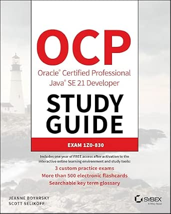

# Oracle Java SE 25 Developer Professional (1Z0-831)

A practical study guide, topic notes and runnable Java examples for the **Oracle Java SE 25 Developer Professional** certification.

This repository brings together the resources I used, the approaches I found effective and the Java examples I wrote to explore tricky language behaviour. It is intended to complement the official exam objectives and published study materials, rather than replace them.

## How I approached preparation

My preparation worked best when I combined a **broad foundation**, **Java 25-specific material**, **realistic mock exams** and **careful review of mistakes**.

I began with a Java SE 21 study guide to refresh the core language and API topics. I then used Java 25-focused material to cover newer features and the subtleties that a general foundation book could miss. Finally, I spent time on realistic practice exams and, crucially, on understanding *why* my answers were right or wrong.

The biggest improvement in my understanding came from reviewing mock-exam results with ChatGPT. Instead of just checking the answer key, I investigated overload resolution, compile-time versus runtime behaviour, API details, concurrency, streams and other common traps. Writing and running small Java examples helped turn those explanations into knowledge I could apply.

**My main advice:** don't measure progress only by chapters read or mock exams completed. Spend time explaining each mistake, testing your assumptions in code and revisiting your weak areas.

## The resources I used

### 1. Java SE 21 study guide — ★★★☆☆ (3/5)

[OCP Oracle Certified Professional Java SE 21 Developer Study Guide (1Z0-830)](https://www.amazon.co.uk/Oracle-Certified-Professional-Developer-Study/dp/1394286619) — also available through [O'Reilly](https://learning.oreilly.com/library/view/ocp-oracle-certified/9781394286614/).

This was a useful starting point. The explanations are accessible, the chapter structure is clear, and the examples help refresh the fundamentals. I have used earlier editions from these authors successfully.

However, I found it too close in approach to the Java SE 17 material to rely on alone for Java SE 25 preparation. It covers a great deal of the shared syllabus, but I wanted more depth on the nuanced questions and newer features relevant to 1Z0-831. I did **not** take the Java SE 21 exam, so this is a judgement about the book's usefulness for **Java 25**, not a direct comparison of the two exams.

**Best use:** build or refresh your foundation, then supplement it with material targeted at Java SE 25.

### 2. Java 25 Exam Fundamentals — ★★★★☆ (4/5)

**OCP Java 25 Exam Fundamentals (1Z0-831)** by Hanumant Deshmukh.

This book felt more closely tailored to the Java 25 syllabus, particularly where the objectives extend beyond the material covered by a Java 21 foundation guide. It helped me focus on the relevant APIs, newer features and exam-specific details.

The book suggests a study schedule of around two hours a night for six months. I read all the chapters apart from the introductory *Kickstarter* chapter in approximately three weeks. I deliberately skipped the end-of-chapter exercises to prioritise reading and mock-exam practice. That was a personal time-management choice, **not** a recommendation that everyone should skip the exercises.

**Best use:** bridge the gap between Java 21 fundamentals and the specific demands of Java SE 25.

### 3. Enthuware Java SE 25 practice exams — ★★★★★ (5/5)

[Enthuware OCP Java Programmer SE 25 practice exams (1Z0-831)](https://sites.fastspring.com/enthuware/product/1z0831)

These were my most valuable practice resource. The questions were highly relevant to the syllabus and, in my experience, similar to the real exam in **difficulty, length and subject matter**. They also exposed details and edge cases that I had not explored sufficiently through the Java 21 material.

Working through the exams gave me a clear sense of progression. But the real benefit was the review afterwards: identifying patterns in my mistakes, understanding the traps and testing unfamiliar behaviour in the IDE.

**Best use:** treat each mock as a diagnostic tool. Review every incorrect answer and any correct answer you reached through guesswork or uncertain reasoning. Use the results to decide what to study next.

### 4. Other practice exams

I also tried two Udemy courses. Both provided extra practice, although I found their usefulness varied considerably.

| Course | Rating | My experience |
|---|---|---|
| [Java SE 25 Developer Professional 1Z0-831 Practice Tests](https://www.udemy.com/course/java-se-25-developer-professional-1z0-831-practice-tests/) | ★★☆☆☆ | Three tests with some useful explanations, but I encountered mismatched questions and answers, outdated assumptions and poorly formatted code. Much less representative of the real exam's difficulty. |
| [Java 25 Professional Certification — 6 Full Tests](https://www.udemy.com/course/ocp-oracle-certified-professional-java-developer-prep/) | ★★★★☆ | More challenging and closer to the length and style of the real exam. Detailed explanations were helpful, although some edge cases felt unusually niche or ambiguous. |

For the strongest exam-specific practice, I would prioritise **Enthuware** over these alternatives.

## A study method I'd recommend

1. **Start with the official objectives.** Use them as a checklist, rather than assuming any single book covers every detail.
2. **Build a foundation.** Work through the core Java language, collections, streams, concurrency, I/O, modules and related APIs. Don't spend equal time on topics you already know well.
3. **Cover Java 25 additions explicitly.** Study features introduced since Java 21, and pay attention to changes in existing APIs.
4. **Take realistic mock exams.** Track your performance over time, but avoid treating a score as the only measure of readiness.
5. **Review deeply.** For each mistake, ask which rule you misunderstood, which distractor caught you and how to recognise the same trap in a different question.
6. **Experiment in Java.** Create small, runnable examples to verify overloads, exception handling, ordering, streams, concurrency and other subtle behaviour. Then revisit the weak areas.

I used ChatGPT as a review partner to challenge my reasoning and explain alternatives. It was especially helpful when I could paste a question, explain my chosen answer and work through why it did or did not hold. I still verified important behaviour using the JDK and runnable code rather than relying on an AI explanation alone.

## Explore the repository

The notes below follow the 14-chapter structure of the Java SE 21 study guide. They focus on points I wanted to reinforce, including exam-specific nuances and places where Java 25 differs. **They are selective notes, not a complete replacement for the books or the official syllabus.**

### Java 21 foundation topics

| Chapter | README | Description |
|---|---|---|
| 01 - Building Blocks                 | [README](src/rysharp/base/chapter/_01_Building_Blocks/README.md) | Java basics, variables, flow |
| 02 - Operators                       | [README](src/rysharp/base/chapter/_02_Operators/README.md) | Operators and expressions    |
| 03 - Making Decisions                | [README](src/rysharp/base/chapter/_03_Making_Decisions/README.md) | Conditionals, switch, loops  |
| 04 - Core APIs                       | [README](src/rysharp/base/chapter/_04_Core_APIs/README.md) | Strings, arrays, dates       |
| 05 - Methods                         | [README](src/rysharp/base/chapter/_05_Methods/README.md) | Methods, parameters          |
| 06 - Class Design                    | [README](src/rysharp/base/chapter/_06_Class_Design/README.md) | Classes, inheritance         |
| 07 - Beyond Classes                  | [README](src/rysharp/base/chapter/_07_Beyond_Classes/README.md) | Abstract, sealed, records    |
| 08 - Lambdas & Functional Interfaces | [README](src/rysharp/base/chapter/_08_Lambdas_and_Functional_Interfaces/README.md) | Lambdas, functional APIs     |
| 09 - Collections & Generics          | [README](src/rysharp/base/chapter/_09_Collections_and_Generics/README.md) | Collections, generics        |
| 10 - Streams                         | [README](src/rysharp/base/chapter/_10_Streams/README.md) | Streams, pipelines           |
| 11 - Exceptions & Localisation       | [README](src/rysharp/base/chapter/_11_Exceptions_and_Localisation/README.md) | Exceptions, localisation     |
| 12 - Modules                         | [README](src/rysharp/base/chapter/_12_Modules/README.md) | Java modules                 |
| 13 - Concurrency                     | [README](src/rysharp/base/chapter/_13_Concurrency/README.md) | Threads, concurrency         |
| 14 - Input/Output                    | [README](src/rysharp/base/chapter/_14_Input_Output/README.md) | Input/Output                 |

### Java 25 addendum

These notes cover relevant additions introduced across JDK 22–25.

| Feature                                                  | Description                                                    | README                                                                                  |
|----------------------------------------------------------|----------------------------------------------------------------|-----------------------------------------------------------------------------------------|
| Flexible Constructor Bodies (JEP 513)                    | Allows statements in constructor before `super()` or `this()`. | [README](src/rysharp/addendum/Flexible_Constructor_Bodies/README.md)                    |
| Unnamed Variables and Patterns (`_`)                     | Use `_` for unused variables.                                  | [README](src/rysharp/addendum/Unnamed_Variables/README.md)                              |
| Module Import Declarations (JEP 511)                     | `import module java.base;`                                     | [README](src/rysharp/addendum/Module_Import_Declarations/README.md)                     |
| Compact Source Files and Instance Main Methods (JEP 512) | Streamlined main methods.                                      | [README](src/rysharp/addendum/Compact_Source_Files_and_Instance_Main_Methods/README.md) |
| Stream Gatherers                                         | Flexible intermediate operations.                              | [README](src/rysharp/addendum/Stream_Gatherers/README.md)                               |
| Scoped Values (JEP 506)                                  | Immutable alternative to thread-local variables.               | [README](src/rysharp/addendum/Scoped_Values/README.md)                                  |
| Minor API Additions                                      | Various small updates.                                         | [README](src/rysharp/addendum/Minor_Api_Additions/README.md)                            |

For the broader platform changes, see the [Oracle JDK 25 release notes](https://www.oracle.com/asean/java/technologies/javase/25-relnote-issues.html). Enthuware also publishes a [Java 25 exam objectives comparison](https://enthuware.com/ocajp-8-fundamentals/114-resources/ocajp-ocpjp-resources).

### Runnable Java examples

The Java files sit alongside their relevant chapters or addendum topics in `code` and `code/practice` directories. Each topic README links to the corresponding examples, so you can explore a feature and run the code without hunting through a separate exam-preparation folder.

Notes from some third-party practice tests are in [`docs/practice-exams`](docs/practice-exams).

---

**Final thought:** the combination that worked best for me was **targeted reading → realistic practice → thorough review → runnable experiments**. The mock exams showed me what I needed to improve; investigating the answers was what made the difference.
