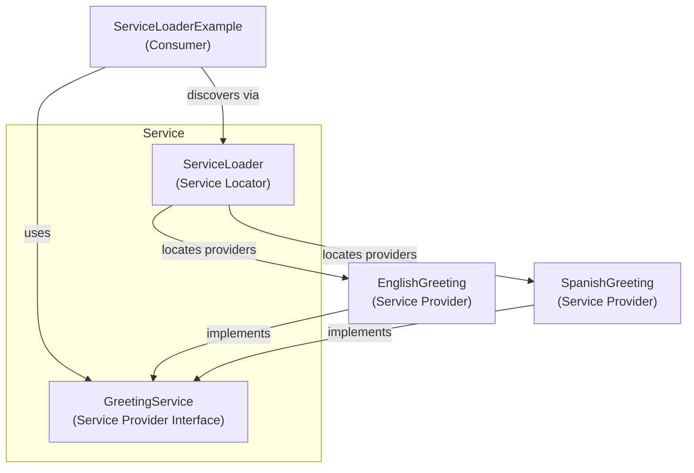

# ServiceLoaderExample — Service Provider Interface (SPI)

This example demonstrates Java's Service Provider Interface (SPI) mechanism using `ServiceLoader` to discover implementations of `GreetingService`.

## Architecture



## Class responsibilities


## Class responsibilities

| Class / File                                                           | Role                                                                         |
|------------------------------------------------------------------------|------------------------------------------------------------------------------|
| [GreetingService.java](../code/service/GreetingService.java)           | **Service Provider Interface (SPI)** — defines the contract                  |
| `java.util.ServiceLoader`                                              | **Service Locator** — discovers registered implementations                   |
| [ServiceLoaderExample.java](../code/service/ServiceLoaderExample.java) | **Consumer** — requests and uses providers                                   |
| [EnglishGreeting.java](../code/service/EnglishGreeting.java)           | **Service Provider** — English implementation                                |
| [SpanishGreeting.java](../code/service/SpanishGreeting.java)           | **Service Provider** — Spanish implementation                                |
| `META-INF/services/...GreetingService`                                 | **Provider Configuration File** — registers implementations on the classpath |


## Module declarations

**API module — `greeting.api`**

```java
module greeting.api {
    exports com.example.greeting.api;
}
```

**Provider module — `greeting.provider`**

```java
module greeting.provider {
    requires greeting.api;

    provides com.example.greeting.api.GreetingService
        with com.example.greeting.provider.EnglishGreeting,
             com.example.greeting.provider.SpanishGreeting;
}
```

**Consumer module — `greeting.consumer`**

```java
module greeting.consumer {
    requires greeting.api;

    uses com.example.greeting.api.GreetingService;
}
```

These declarations illustrate a properly separated modular application. The runnable examples currently use one package on the classpath instead.