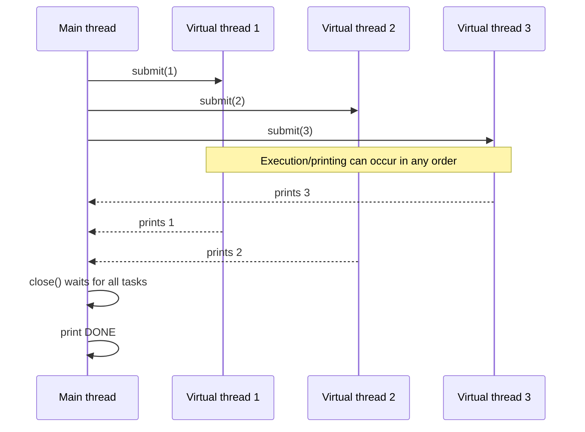
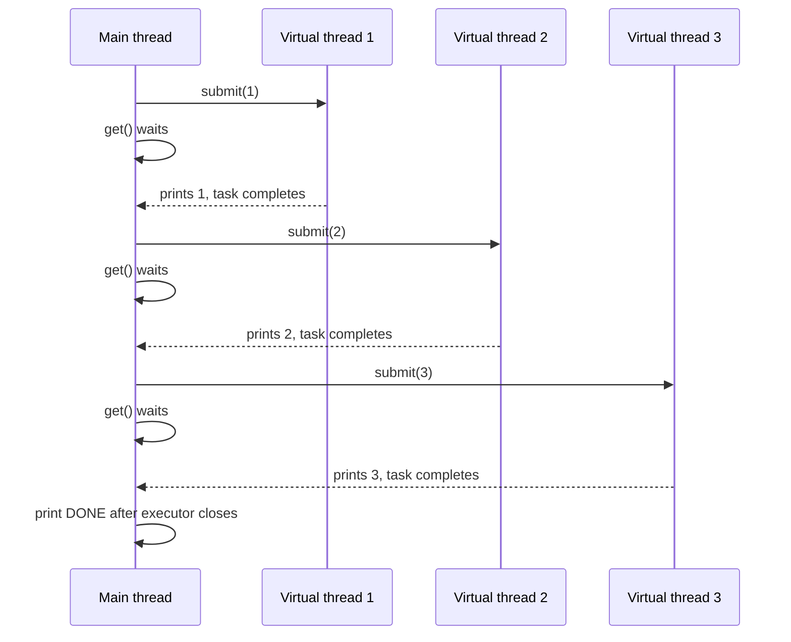
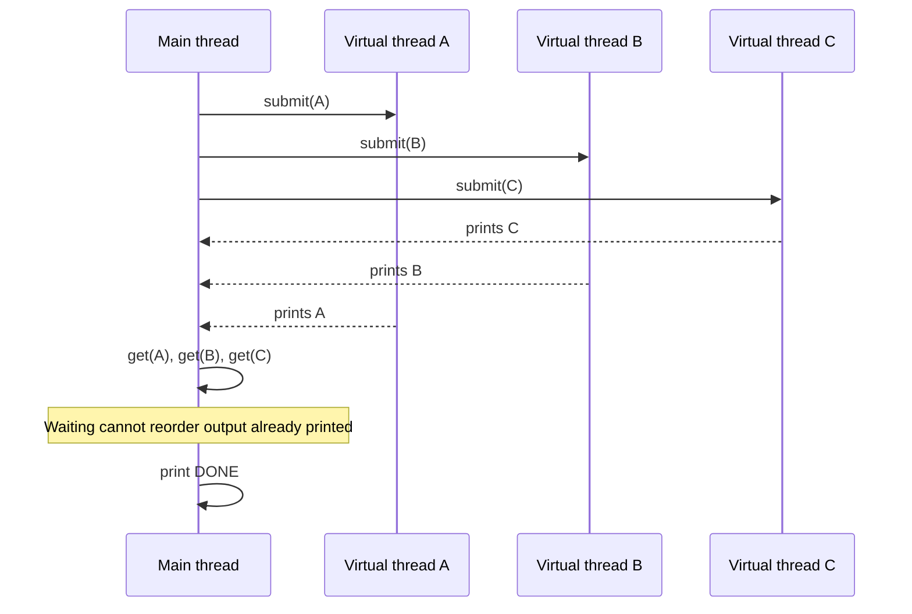
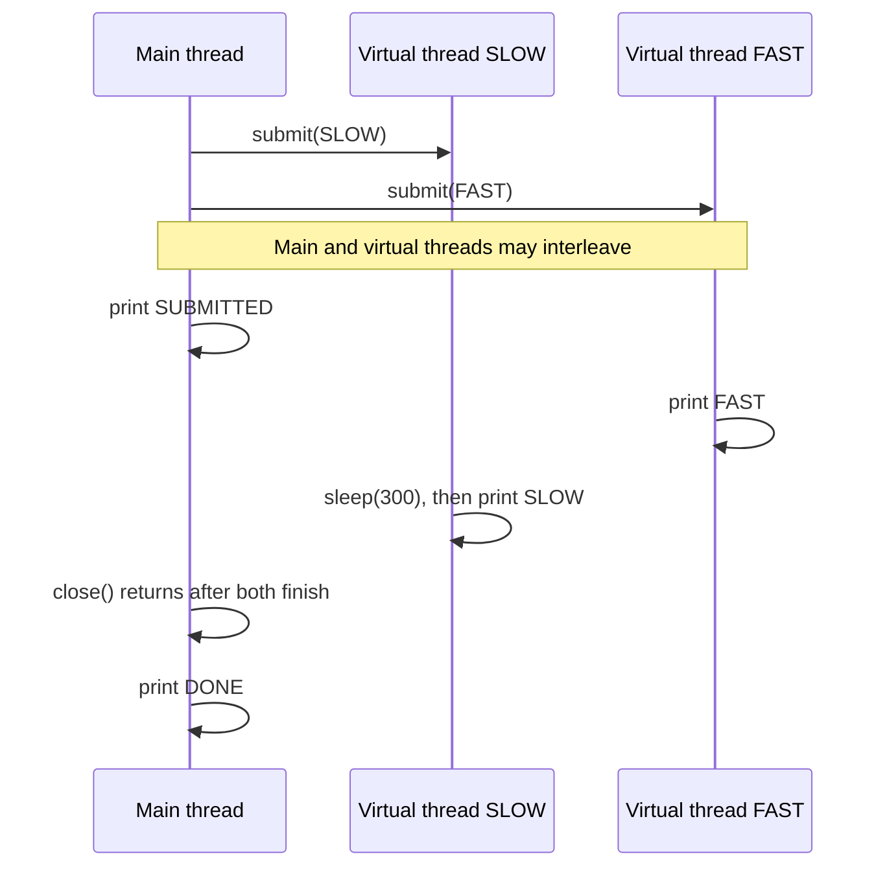
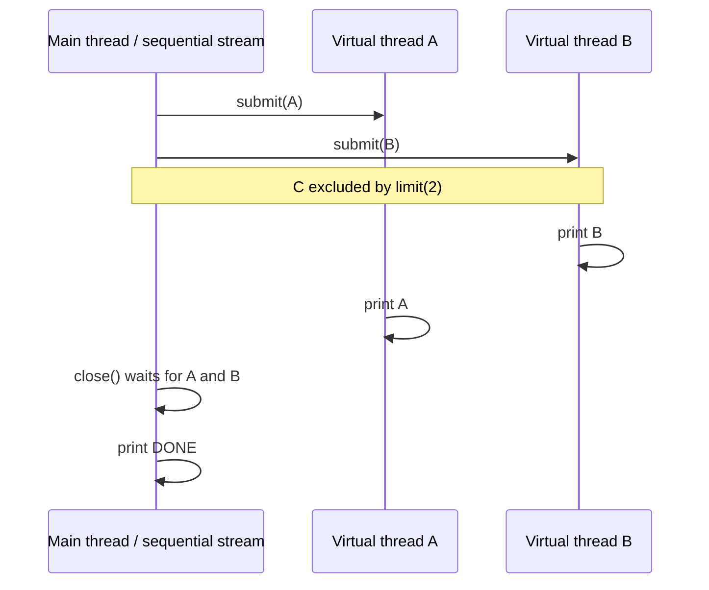
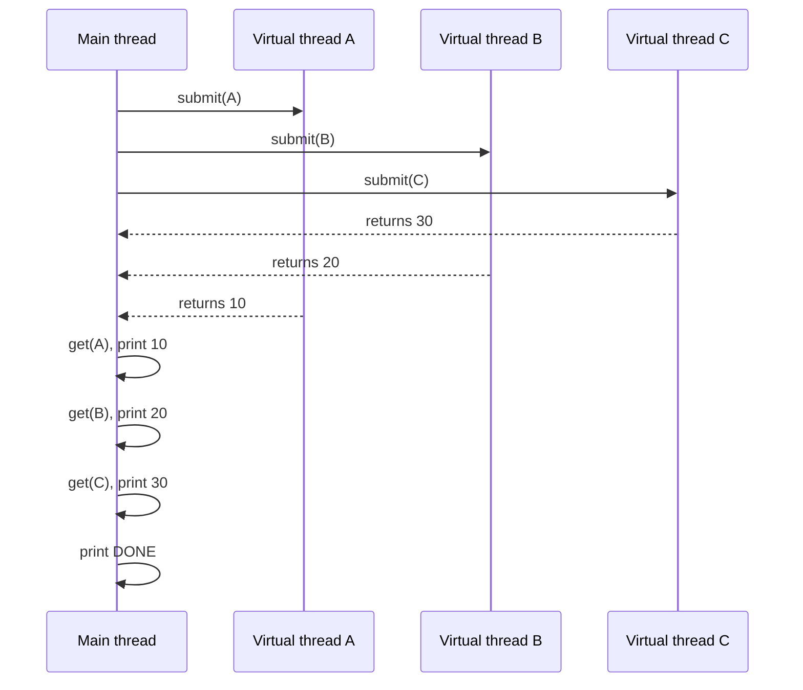

# Virtual Thread Executor — Execution Ordering

[🔙 Back](../README.md)

Companion notes for [`NewVirtualThreadPerTaskExecutorExample.java`](../code/NewVirtualThreadPerTaskExecutorExample.java).

`Executors.newVirtualThreadPerTaskExecutor()` starts a new virtual thread for each submitted task. **Submission order does not guarantee execution or completion order.**

## `submit()`, `get()` and `close()`

| Operation | What happens | Ordering guarantee |
|---|---|---|
| `submit(task)` | Schedules a task and immediately returns a `Future` | None for task execution |
| `future.get()` | Waits for that task to complete and retrieves its result | Only orders subsequent actions on the *calling* thread |
| `executor.close()` | Waits for submitted tasks to finish | Code after `close()` runs after task completion, but tasks remain unordered |

## Example 1 — Submit Without `get()`

```java
try (var executor = Executors.newVirtualThreadPerTaskExecutor()) {
    for (int i = 1; i <= 5; i++) {
        int task = i;
        executor.submit(() -> System.out.print(task + " "));
    }
}
System.out.println("DONE");
```



Illustrative output: `3 1 2 4 5 DONE`. All five values appear before `DONE`, but their order is not guaranteed.

## Example 2 — `get()` Inside the Loop

```java
try (var executor = Executors.newVirtualThreadPerTaskExecutor()) {
    for (int i = 1; i <= 5; i++) {
        int task = i;
        executor.submit(() -> System.out.print(task + " ")).get();
    }
}
System.out.println("DONE");
```



Guaranteed output: `1 2 3 4 5 DONE`.

**Why?** The main thread cannot submit the next task until the previous task's `get()` returns.

## Example 3 — Submit All, Then Call `get()`

```java
List<Future<?>> futures = new ArrayList<>();
try (var executor = Executors.newVirtualThreadPerTaskExecutor()) {
    for (int i = 1; i <= 5; i++) {
        int task = i;
        futures.add(executor.submit(() -> System.out.print(task + " ")));
    }
    for (Future<?> future : futures) {
        future.get();
    }
}
System.out.println("DONE");
```



The virtual threads print directly, so their output remains unordered even though the main thread calls `get()` in submission order.

## Example 4 — `close()` Waits for All Tasks

```java
try (var executor = Executors.newVirtualThreadPerTaskExecutor()) {
    executor.submit(() -> {
        sleep(300);
        System.out.print("SLOW ");
    });
    executor.submit(() -> System.out.print("FAST "));
    System.out.print("SUBMITTED ");
}
System.out.println("DONE");
```



Typical output: `SUBMITTED FAST SLOW DONE`. The relative order of `SUBMITTED`, `FAST`, and `SLOW` is not guaranteed; **`DONE` is always last** after normal completion. The diagram shows one possible interleaving.

## Example 5 — Sequential Stream, Concurrent Tasks

```java
try (var executor = Executors.newVirtualThreadPerTaskExecutor()) {
    Stream.of("A", "B", "C")
            .limit(2)
            .forEach(s -> executor.submit(() -> System.out.print(s)));
}
System.out.println("DONE");
```



Possible outputs: `ABDONE` or `BADONE`. **Sequential submission is not sequential execution.** The diagram illustrates the `BADONE` case.

## Example 6 — Submit All, Then Print Returned Values

```java
List<Future<Integer>> futures = new ArrayList<>();
try (var executor = Executors.newVirtualThreadPerTaskExecutor()) {
    for (int i = 1; i <= 5; i++) {
        int task = i;
        futures.add(executor.submit(() -> task * 10));
    }
    for (Future<Integer> future : futures) {
        System.out.print(future.get() + " ");
    }
}
System.out.println("DONE");
```



Guaranteed output: `10 20 30 40 50 DONE`.

**Why?** The tasks return values without printing. The **main thread** prints the values in the order it iterates over the futures. Task completion order is still unpredictable.

## Quick Reference

| Example | Who prints? | When is `get()` called? | Printed order |
|---|---|---|---|
| 1 | Virtual threads | Never | Unpredictable |
| 2 | Virtual threads | Immediately after each submission | Submission order |
| 3 | Virtual threads | After all submissions | Unpredictable |
| 4 | Main and virtual threads | Never | `DONE` last; earlier output may vary |
| 5 | Virtual threads | Never | A/B unordered; `DONE` last |
| 6 | Main thread | After all submissions | Future list order |

## Final Memory Kicks

> **`submit()` schedules; `get()` waits for one task; `close()` waits for all submitted tasks.**
>
> **`get()` does not start a task or reorder output produced inside it.**
>
> **Printing inside tasks is unordered; printing returned values in future-list order is ordered.**
>
> **A sequential stream can submit concurrent tasks.**
