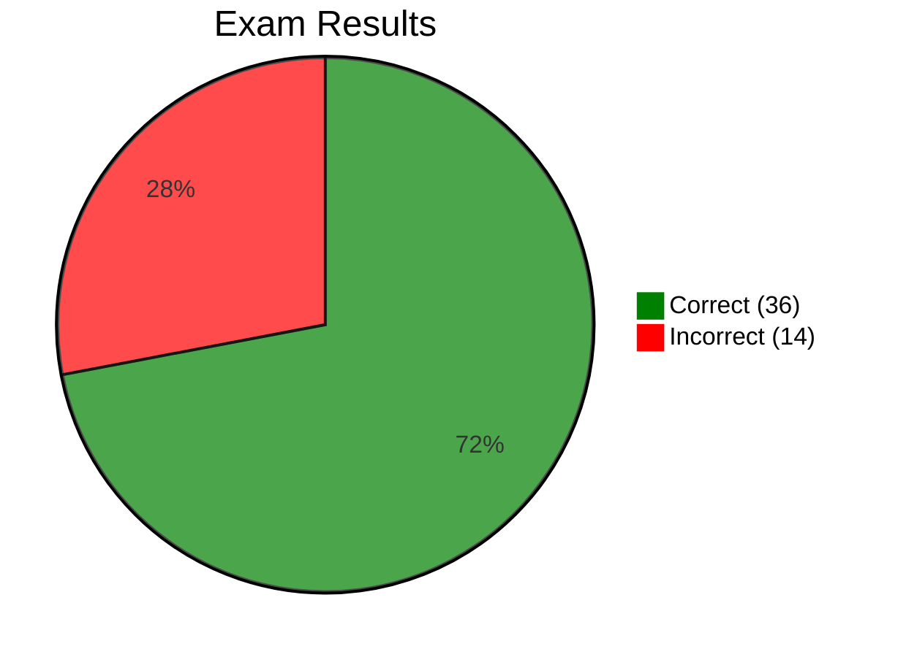

# Practice Exam 2 — Review

[🔙 Back](../../../README.md)

Exam 2 of 6 from [Java 25 Professional Certification - 6 full Tests (1Z0-831)](https://www.udemy.com/course/ocp-oracle-certified-professional-java-developer-prep/).

## 📝 Results

**Score:** 36 / 50 (72%)  
**Pass mark:** 68%  
**Difference from pass:** 2 questions above  
**Time taken:** 1 hour 22 minutes  
**Improvement:** **+4 questions / +8 percentage points**

## 🔎 Overview

Practice Exam 2 was the first passing result, improving from 64% in PE1 to 72%.

All 50 questions were reviewed to distinguish genuine knowledge gaps from correct answers reached through reasoning, elimination or guesswork.

The main weaknesses were functional interface APIs, switch compilation rules, `var` array syntax and specific I/O methods. Exception handling was answered correctly but remains a priority for building confidence in execution order.

Several previously revised topics showed improvement, particularly collections, executor services and Java 25 unnamed variables.

The goal is therefore **targeted revision**, prioritising recurring mistakes and answers that exposed uncertainty.

---

## ❌ Incorrect Answers

| Question | Area | What Went Wrong | What to Review | Repo Section |
|---|---|---|---|---|
| Q3 | Polymorphism | Assumed `o2.toString()` would use `Object.toString()` rather than the runtime `Integer` implementation. | Runtime method dispatch; declared versus runtime types; `equals()` | [**06 - Class Design**](../base/chapter/_06_Class_Design/README.md) |
| Q11 | Switch | Expected `Seine, Corsica` if compilation succeeded, but thought `case 'a' \| 'b':` was invalid. | Constant expressions in case labels; bitwise OR; fall-through | [**03 - Making Decisions**](../base/chapter/_03_Making_Decisions/README.md) |
| Q15 | Functional interfaces | Expected `7`, overlooking that `BiFunction` has no `compose()` method. | `Function.compose()` versus `andThen()`; `BiFunction` methods | [**08 - Lambdas & Functional Interfaces**](../base/chapter/_08_Lambdas_and_Functional_Interfaces/README.md) |
| Q17 | Console API | Guessed between `read()` and `reader()` and selected the wrong method. | `Console` methods; distinction between `Console.reader()` and `Reader.read()` | [**14 - Input/Output**](../base/chapter/_14_Input_Output/README.md) |
| Q20 | Arrays / `var` | Knew `array5` was valid but overlooked `var array1 = new String[]{...}` while questioning other declarations. | Valid array declarations; `var` with arrays; array initializers | [**01 - Building Blocks**](../base/chapter/_01_Building_Blocks/README.md) |
| Q26 | `var` | Interpreted the question as asking for valid rather than invalid declarations. Also exposed recurring uncertainty with array brackets. | `var` declaration restrictions; question wording; negative selection criteria | [**01 - Building Blocks**](../base/chapter/_01_Building_Blocks/README.md) |
| Q28 | Concurrency | Knew `limit(25)` meant 25 values but assumed a sequential stream guaranteed ordered printing by separate virtual threads. | Task submission versus execution order; virtual-thread executors | [**13 - Concurrency**](../base/chapter/_13_Concurrency/README.md) |
| Q29 | Pattern switch | Expected the `String` case to match; overlooked fall-through into subsequent pattern labels. | Pattern switch fall-through restrictions; colon syntax versus `->` | [**03 - Making Decisions**](../base/chapter/_03_Making_Decisions/README.md) |
| Q31 | Predicate | Knew `test()` was abstract but couldn't distinguish static from default methods. | `and()`, `or()`, `negate()`, `not()`, `isEqual()` | [**08 - Lambdas & Functional Interfaces**](../base/chapter/_08_Lambdas_and_Functional_Interfaces/README.md) |
| Q37 | Functional interfaces | Was uncertain whether `BooleanSupplier` existed and failed to identify the nonexistent `BiSupplier`. | Supplier variants; valid functional interface names | [**08 - Lambdas & Functional Interfaces**](../base/chapter/_08_Lambdas_and_Functional_Interfaces/README.md) |
| Q42 | Generics | Assumed a `List<String>` variable could be inserted into a map requiring `ArrayList<String>` because its runtime object was an `ArrayList`. | Declared types; generic invariance; wildcard restrictions; diamond inference | [**09 - Collections & Generics**](../base/chapter/_09_Collections_and_Generics/README.md) |
| Q43 | Files API | Confused `Files.readAllLines()` with `Files.lines()`, expecting a stream rather than a list. | Files API method return types | [**14 - Input/Output**](../base/chapter/_14_Input_Output/README.md) |
| Q46 | Interfaces | Thought an interface could provide a `default` implementation of `equals(Object)`. | Interface default-method restrictions involving `Object` methods | [**07 - Beyond Classes**](../base/chapter/_07_Beyond_Classes/README.md) |
| Q47 | Sealed classes | Was uncertain whether `final` and `sealed` could be combined. | Required modifiers for direct subclasses of sealed classes | [**07 - Beyond Classes**](../base/chapter/_07_Beyond_Classes/README.md) |

---

## ✅ Correct Answers

All correct answers are logged here to retain evidence of strengths as well as weaknesses. Questions that exposed uncertainty are also examined separately below.

| Question | Repo Section |
|---|---|
| Q2 | [**10 - Streams**](../base/chapter/_10_Streams/README.md) |
| Q4 | [**03 - Making Decisions**](../base/chapter/_03_Making_Decisions/README.md) |
| Q5 | [**Unnamed Variables and Patterns**](../addendum/Unnamed_Variables/README.md) |
| Q8 | [**09 - Collections & Generics**](../base/chapter/_09_Collections_and_Generics/README.md) |
| Q9 | [**01 - Building Blocks**](../base/chapter/_01_Building_Blocks/README.md) |
| Q10 | [**09 - Collections & Generics**](../base/chapter/_09_Collections_and_Generics/README.md) |
| Q12 | [**13 - Concurrency**](../base/chapter/_13_Concurrency/README.md) |
| Q13 | [**09 - Collections & Generics**](../base/chapter/_09_Collections_and_Generics/README.md) |
| Q16 | [**13 - Concurrency**](../base/chapter/_13_Concurrency/README.md) |
| Q18 | [**03 - Making Decisions**](../base/chapter/_03_Making_Decisions/README.md) |
| Q19 | [**06 - Class Design**](../base/chapter/_06_Class_Design/README.md) |
| Q22 | [**08 - Lambdas & Functional Interfaces**](../base/chapter/_08_Lambdas_and_Functional_Interfaces/README.md) |
| Q23 | [**Unnamed Variables and Patterns**](../addendum/Unnamed_Variables/README.md) |
| Q24 | [**01 - Building Blocks**](../base/chapter/_01_Building_Blocks/README.md) |
| Q27 | [**13 - Concurrency**](../base/chapter/_13_Concurrency/README.md) |
| Q30 | [**03 - Making Decisions**](../base/chapter/_03_Making_Decisions/README.md) |
| Q33 | [**05 - Methods**](../base/chapter/_05_Methods/README.md) |
| Q34 | [**02 - Operators**](../base/chapter/_02_Operators/README.md) |
| Q35 | [**12 - Modules**](../base/chapter/_12_Modules/README.md) |
| Q36 | [**08 - Lambdas & Functional Interfaces**](../base/chapter/_08_Lambdas_and_Functional_Interfaces/README.md) |
| Q39 | [**13 - Concurrency**](../base/chapter/_13_Concurrency/README.md) |
| Q40 | [**14 - Input/Output**](../base/chapter/_14_Input_Output/README.md) |
| Q44 | [**07 - Beyond Classes**](../base/chapter/_07_Beyond_Classes/README.md) |
| Q45 | [**01 - Building Blocks**](../base/chapter/_01_Building_Blocks/README.md) |
| Q48 | [**06 - Class Design**](../base/chapter/_06_Class_Design/README.md) |
| Q49 | [**07 - Beyond Classes**](../base/chapter/_07_Beyond_Classes/README.md) |
| Q50 | [**02 - Operators**](../base/chapter/_02_Operators/README.md) |

---

## ✅ Correct Answers That Exposed Uncertainty 🤔

These answers were correct but exposed knowledge that was not completely secure. They are lower priority than incorrect answers but useful indicators for targeted revision.

| Question | Area | Observation | Repo Section |
|---|---|---|---|
| Q1 | Exceptions | Correctly reasoned through the exception flow but needed time. Wants greater certainty. | [**11 - Exceptions & Localisation**](../base/chapter/_11_Exceptions_and_Localisation/README.md) |
| Q6 | Exceptions | Initially selected `bim boom bam`, then corrected to `bim bam boom`. Nearly lost the mark. | [**11 - Exceptions & Localisation**](../base/chapter/_11_Exceptions_and_Localisation/README.md) |
| Q7 | Modules | Answered by elimination; recognised `--module-source-path` but wasn't confident. | [**12 - Modules**](../base/chapter/_12_Modules/README.md) |
| Q14 | Concurrent collections | Correct answer, but wanted clarification about visibility of changes during `CopyOnWriteArrayList` iteration. | [**13 - Concurrency**](../base/chapter/_13_Concurrency/README.md) |
| Q21 | Summary statistics | Had not encountered `DoubleSummaryStatistics.accept()` or `combine()`; answered logically. | [**10 - Streams**](../base/chapter/_10_Streams/README.md) |
| Q25 | Optional / exceptions | Followed the execution correctly but questioned when `orElseThrow()` creates and throws the exception. | [**10 - Streams**](../base/chapter/_10_Streams/README.md) |
| Q32 | Date/time API | Had not studied `Year` or `atMonthDay()`; answered through deduction. | [**04 - Core APIs**](../base/chapter/_04_Core_APIs/README.md) |
| Q38 | Sealed classes / reflection | Had not used `isSealed()`; inferred the answer from the options. | [**07 - Beyond Classes**](../base/chapter/_07_Beyond_Classes/README.md) |
| Q41 | Exceptions | Reasoned through the execution order; the result helped clarify Q6. | [**11 - Exceptions & Localisation**](../base/chapter/_11_Exceptions_and_Localisation/README.md) |

---

## 🚩 Review Priority

| Priority | Repo Section | Evidence from Exam | Review Focus |
|---|---|---|---|
| 🔴 **High** | [**08 - Lambdas & Functional Interfaces**](../base/chapter/_08_Lambdas_and_Functional_Interfaces/README.md) | ❌ Q15, Q31, Q37 | Functional interface names and available methods |
| 🔴 **High** | [**01 - Building Blocks**](../base/chapter/_01_Building_Blocks/README.md) | ❌ Q20, Q26 · 🤔 Q45 | `var`, array declarations and initializers |
| 🔴 **High** | [**03 - Making Decisions**](../base/chapter/_03_Making_Decisions/README.md) | ❌ Q11, Q29 | Switch constant expressions and pattern fall-through |
| 🔴 **High** | [**11 - Exceptions & Localisation**](../base/chapter/_11_Exceptions_and_Localisation/README.md) | 🤔 Q1, Q6, Q41 | Exception execution order and propagation |
| 🟠 **Medium** | [**09 - Collections & Generics**](../base/chapter/_09_Collections_and_Generics/README.md) | ❌ Q42 | Generic assignability and type inference |
| 🟠 **Medium** | [**14 - Input/Output**](../base/chapter/_14_Input_Output/README.md) | ❌ Q17, Q43 | Console and Files API methods |
| 🟠 **Medium** | [**13 - Concurrency**](../base/chapter/_13_Concurrency/README.md) | ❌ Q28 · 🤔 Q14 | Execution ordering and snapshot iteration |
| 🟠 **Medium** | [**07 - Beyond Classes**](../base/chapter/_07_Beyond_Classes/README.md) | ❌ Q46, Q47 · 🤔 Q38 | Interface default methods and sealed classes |
| 🟠 **Medium** | [**12 - Modules**](../base/chapter/_12_Modules/README.md) | 🤔 Q7 | Module compilation flags |
| 🟡 **Targeted** | [**04 - Core APIs**](../base/chapter/_04_Core_APIs/README.md) | 🤔 Q32 | `Year`, `MonthDay` and related APIs |
| 🟡 **Targeted** | [**10 - Streams**](../base/chapter/_10_Streams/README.md) | 🤔 Q21, Q25 | Summary statistics and `Optional` methods |

### Evidence Key

- ❌ Incorrect
- 🤔 Correct, but exposed uncertainty
- ✅ Correct without identified concern

---

## JDK 25 Addendum

| Addendum Topic | Exam 2 Finding | Assessment |
|---|---|---|
| [Unnamed Variables and Patterns (`_`)](../addendum/Unnamed_Variables/README.md) | Q5, Q23 | Confident; earlier revision retained |
| [Flexible Constructor Bodies (JEP 513)](../addendum/Flexible_Constructor_Bodies/README.md) | — | No specific gap identified |
| [Module Import Declarations (JEP 511)](../addendum/Module_Import_Declarations/README.md) | — | No specific gap identified; Q7 concerned JPMS compilation flags |
| [Compact Source Files and Instance Main Methods (JEP 512)](../addendum/Compact_Source_Files_and_Instance_Main_Methods/README.md) | — | No specific gap identified |
| [Stream Gatherers](../addendum/Stream_Gatherers/README.md) | — | No specific gap identified |
| [Scoped Values (JEP 506)](../addendum/Scoped_Values/README.md) | — | No specific gap identified |
| [Minor API Additions](../addendum/Minor_Api_Additions/README.md) | — | No specific Java 25 addition identified as a gap |

**Note:** Q18 involved primitive patterns, whose Java 25 preview status should be distinguished from the certification's non-preview language rules.

---

## Overall Assessment

**PASS — 72% (36/50)**

An improvement of four correct answers and eight percentage points over PE1, moving from two questions below the pass mark to two questions above it.

**Strengths:** Good retention of PE1 revision, particularly collections and executor services; confident Java 25 unnamed-variable knowledge; strong reasoning about class design, access control and common APIs.

**Weaknesses:** Exact functional-interface APIs, switch compilation rules, `var` array declarations and selected I/O methods. Exception handling is a confidence-building priority despite correct answers.

**Exam technique:** Q20 and Q26 exposed avoidable errors from overthinking alternatives and reversing the question's selection criteria. Multi-select questions need particular care.

**Next steps:** Address the high-priority gaps in the relevant revision guides, reinforce the medium-priority API details, then attempt PE3.

The aim is to move from a narrow pass to a consistent, comfortable margin above 68%.