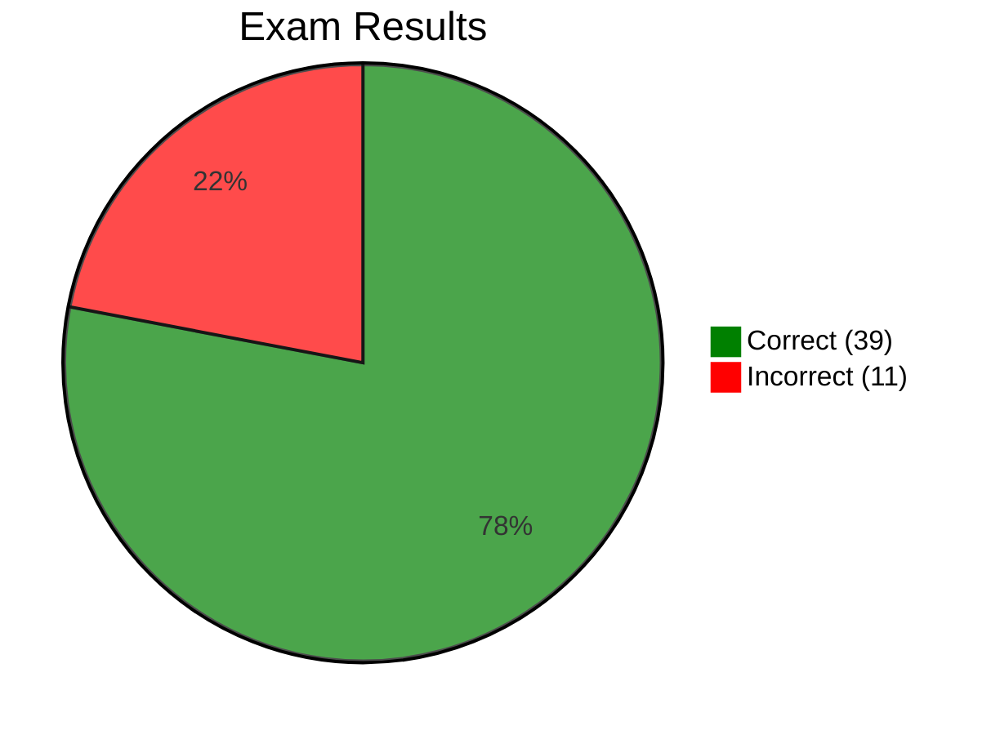

# Practice Exam 3 — Review

[🔙 Back](../../../README.md)

Exam 3 of 6 from [Java 25 Professional Certification - 6 full Tests (1Z0-831)](https://www.udemy.com/course/ocp-oracle-certified-professional-java-developer-prep/).

## 📝 Results

**Score:** 39 / 50 (78%)  
**Pass mark:** 68%  
**Difference from pass:** 5 questions above the pass mark  
**Time taken:** 1 hour 25 minutes 
**Improvement:** **Improvement: +6 percentage points from PE2 (72%) and +14 percentage points from PE1 (64%)**

## 🔎 Overview

The third practice exam was a clear pass and continues the improvement from PE1 (64%) and PE2 (72%) to **78%**. All 50 answers were reviewed, including correct answers that relied on deduction or exposed a misconception.

The main patterns were:

- Most incorrect answers arose from **specific API signatures, return types or compilation rules**, rather than a broad inability to apply Java concepts.
- Core APIs had several distinct gaps: `Integer.decode()`, `DateTimeFormatter` package/pattern symbols, `Math.exp()` numeric conversion and `StringBuilder.chars()`.
- I/O needs targeted reinforcement: try-with-resources syntax, data streams, and distinctions between `File`, `Path` and `Files` operations.
- Collections & Generics exposed confusion over `List.set()` and whether a raw `HashSet` declaration can use `<>`; other collection questions were handled well.
- Lambdas & Functional Interfaces improved considerably, although `BinaryOperator.maxBy()` was unfamiliar.
- Streams, modules, concurrency, class design and localisation supplied substantial evidence of knowledge, with some less-common APIs answered through reasoning rather than recall.
- A small number of correct answers concealed misconceptions, notably `Object.getClass()` being mistaken for a static method.
- The dedicated JDK 25 addendum topics were not directly tested.

The goal remains **targeted revision**, with particular attention to exact API contracts and the distinction between compile-time errors and runtime behaviour.

---

## ❌ Incorrect Answers

| Question | Area | What Went Wrong | What to Review | Repo Section |
|---|---|---|---|---|
| Q2 | Try-with-resources | Treated assignment to an existing variable inside the resource header as valid. | Resource declarations versus references to final/effectively final resources; legal TWR syntax. | [**11 - Exceptions & Localisation**](../base/chapter/_11_Exceptions_and_Localisation/README.md) |
| Q9 | `BinaryOperator.maxBy()` | Did not recognise `maxBy(Comparator)` as a static `BinaryOperator` factory. | `BinaryOperator.minBy/maxBy`; comparator-based selection; `apply(T, T)`. | [**08 - Lambdas & Functional Interfaces**](../base/chapter/_08_Lambdas_and_Functional_Interfaces/README.md) |
| Q11 | `Integer.decode()` | Did not know `Integer.decode(String)` returns `Integer` and can be used with `Stream.map()`. | `decode` versus `parseInt`/`valueOf`; `map` versus `mapToInt` and `boxed()`. | [**04 - Core APIs**](../base/chapter/_04_Core_APIs/README.md) |
| Q13 | Labelled `break` | Traced the break condition correctly but counted outer-loop iterations rather than completed print statements. | Labelled breaks, nested-loop execution and exact output tracing. | [**03 - Making Decisions**](../base/chapter/_03_Making_Decisions/README.md) |
| Q18 | `List.set()` | Assumed `set(size, element)` could append to an `ArrayList`; it throws `IndexOutOfBoundsException`. | `set(index, value)` requires `index < size`; `add(index, value)` permits `index == size`. | [**09 - Collections & Generics**](../base/chapter/_09_Collections_and_Generics/README.md) |
| Q24 | `DateTimeFormatter` package | Did not remember that `DateTimeFormatter` is in `java.time.format`, not `java.time`. | Java time API package structure, especially `java.time`, `.format` and `.temporal`. | [**04 - Core APIs**](../base/chapter/_04_Core_APIs/README.md) |
| Q26 | Date/time format patterns | Overlooked that uppercase `MM` represents month, not minute. | Case-sensitive `DateTimeFormatter` patterns: `MM`/`mm`, `HH`/`hh`, `yy`/`yyyy`. | [**04 - Core APIs**](../base/chapter/_04_Core_APIs/README.md) |
| Q27 | Binary data streams | Confused primitive `double` read/write operations with byte operations. The supplied question also had unrelated checked-exception and buffering problems. | `DataOutputStream.writeDouble()` / `DataInputStream.readDouble()`; checked `IOException`; closing/flushing buffered output before reading. | [**14 - Input/Output**](../base/chapter/_14_Input_Output/README.md) |
| Q28 | `Math.exp()` / numeric conversion | Thought `Math.exp()` returned `long`; its `double` result cannot be assigned to `long` without conversion. | Math return types, widening/narrowing, integer division and `Formatter` conversion requirements. | [**04 - Core APIs**](../base/chapter/_04_Core_APIs/README.md) |
| Q34 | Raw `HashSet` and equality | Suspected that `HashSet bottles = new HashSet<>();` failed to compile; raw references with diamond construction are legal. | Raw types and diamond inference; `HashSet` uniqueness; `equals()`/`hashCode()` contracts. | [**09 - Collections & Generics**](../base/chapter/_09_Collections_and_Generics/README.md) |
| Q37 | `StringBuilder.chars()` | Assumed `chars()` returned `char[]`, suitable for a `String` constructor; it returns `IntStream`. | `CharSequence.chars()` and `codePoints()`; `StringBuilder.toString()`; `String.toCharArray()`. | [**04 - Core APIs**](../base/chapter/_04_Core_APIs/README.md) |

**Question-quality caveat (Q27):** The intended data-stream pairing is `writeDouble()`/`readDouble()`, but the supplied program as a whole does not compile if `main` only declares `throws FileNotFoundException`; those methods can throw `IOException`. Reading before buffered output is flushed or closed is a separate runtime concern. This is an issue with the practice question, not an additional incorrect answer.

---

## ✅ Correct Answers

All correct answers are logged here to retain evidence of strengths as well as weaknesses. Questions that exposed uncertainty are also examined separately below.

| Question | Repo Section |
|---|---|
| Q1 | [**04 - Core APIs**](../base/chapter/_04_Core_APIs/README.md) |
| Q3 | [**11 - Exceptions & Localisation**](../base/chapter/_11_Exceptions_and_Localisation/README.md) |
| Q4 | [**04 - Core APIs**](../base/chapter/_04_Core_APIs/README.md) |
| Q5 | [**10 - Streams**](../base/chapter/_10_Streams/README.md) |
| Q6 | [**13 - Concurrency**](../base/chapter/_13_Concurrency/README.md) |
| Q7 | [**14 - Input/Output**](../base/chapter/_14_Input_Output/README.md) |
| Q8 | [**08 - Lambdas & Functional Interfaces**](../base/chapter/_08_Lambdas_and_Functional_Interfaces/README.md) |
| Q10 | [**06 - Class Design**](../base/chapter/_06_Class_Design/README.md) |
| Q12 | [**04 - Core APIs**](../base/chapter/_04_Core_APIs/README.md) |
| Q14 | [**04 - Core APIs**](../base/chapter/_04_Core_APIs/README.md) |
| Q15 | [**07 - Beyond Classes**](../base/chapter/_07_Beyond_Classes/README.md) |
| Q16 | [**03 - Making Decisions**](../base/chapter/_03_Making_Decisions/README.md) |
| Q17 | [**08 - Lambdas & Functional Interfaces**](../base/chapter/_08_Lambdas_and_Functional_Interfaces/README.md) |
| Q19 | [**07 - Beyond Classes**](../base/chapter/_07_Beyond_Classes/README.md) |
| Q20 | [**05 - Methods**](../base/chapter/_05_Methods/README.md) |
| Q21 | [**07 - Beyond Classes**](../base/chapter/_07_Beyond_Classes/README.md) |
| Q22 | [**09 - Collections & Generics**](../base/chapter/_09_Collections_and_Generics/README.md) |
| Q23 | [**07 - Beyond Classes**](../base/chapter/_07_Beyond_Classes/README.md) |
| Q25 | [**10 - Streams**](../base/chapter/_10_Streams/README.md) |
| Q29 | [**06 - Class Design**](../base/chapter/_06_Class_Design/README.md) |
| Q30 | [**12 - Modules**](../base/chapter/_12_Modules/README.md) |
| Q31 | [**14 - Input/Output**](../base/chapter/_14_Input_Output/README.md) |
| Q32 | [**11 - Exceptions & Localisation**](../base/chapter/_11_Exceptions_and_Localisation/README.md) |
| Q33 | [**06 - Class Design**](../base/chapter/_06_Class_Design/README.md) |
| Q35 | [**11 - Exceptions & Localisation**](../base/chapter/_11_Exceptions_and_Localisation/README.md) |
| Q36 | [**08 - Lambdas & Functional Interfaces**](../base/chapter/_08_Lambdas_and_Functional_Interfaces/README.md) |
| Q38 | [**03 - Making Decisions**](../base/chapter/_03_Making_Decisions/README.md) |
| Q39 | [**06 - Class Design**](../base/chapter/_06_Class_Design/README.md) |
| Q40 | [**12 - Modules**](../base/chapter/_12_Modules/README.md) |
| Q41 | [**10 - Streams**](../base/chapter/_10_Streams/README.md) |
| Q42 | [**13 - Concurrency**](../base/chapter/_13_Concurrency/README.md) |
| Q43 | [**08 - Lambdas & Functional Interfaces**](../base/chapter/_08_Lambdas_and_Functional_Interfaces/README.md) |
| Q44 | [**10 - Streams**](../base/chapter/_10_Streams/README.md) |
| Q45 | [**09 - Collections & Generics**](../base/chapter/_09_Collections_and_Generics/README.md) |
| Q46 | [**09 - Collections & Generics**](../base/chapter/_09_Collections_and_Generics/README.md) |
| Q47 | [**14 - Input/Output**](../base/chapter/_14_Input_Output/README.md) |
| Q48 | [**10 - Streams**](../base/chapter/_10_Streams/README.md) |
| Q49 | [**12 - Modules**](../base/chapter/_12_Modules/README.md) |
| Q50 | [**04 - Core APIs**](../base/chapter/_04_Core_APIs/README.md) |

---

## ✅ Correct Answers That Exposed Uncertainty 🤔

These answers were correct but exposed knowledge that was not completely secure. They are lower priority than incorrect answers but useful indicators for targeted revision.

| Question | Area | Observation | Repo Section |
|---|---|---|---|
| Q10 | `protected` access | Correctly recognised the cross-package access restriction, but the qualifying reference's static type required careful thought. | [**06 - Class Design**](../base/chapter/_06_Class_Design/README.md) |
| Q12 | `Optional.or()` | Correctly inferred that `or()` preserves the present `Optional`, but the API was unfamiliar. A separate short Optional API guide is planned. | [**04 - Core APIs**](../base/chapter/_04_Core_APIs/README.md) |
| Q14 | `LocalDate.ofYearDay()` | Correct through date calculation rather than familiarity with this factory method. | [**04 - Core APIs**](../base/chapter/_04_Core_APIs/README.md) |
| Q22 | `? extends Number` | Correctly applied the producer/consumer rule but briefly questioned the legality of adding concrete values. | [**09 - Collections & Generics**](../base/chapter/_09_Collections_and_Generics/README.md) |
| Q31 | `Files.readAllLines()` | Correctly identified the `File` versus `Path` mismatch, but was unsure whether `readAllLines()` returns `List<String>` or `Stream<String>`. | [**14 - Input/Output**](../base/chapter/_14_Input_Output/README.md) |
| Q35 | `ResourceBundle` variants | Correctly inferred that language/country/variant is the most specific match; limited practical experience with variants. | [**11 - Exceptions & Localisation**](../base/chapter/_11_Exceptions_and_Localisation/README.md) |
| Q38 | Boxing and switch patterns | Correctly selected `Character` but initially questioned whether a `char` passed as `Object` would be boxed or numerically promoted. | [**03 - Making Decisions**](../base/chapter/_03_Making_Decisions/README.md) |
| Q39 | `Object.getClass()` | Correct answer for the wrong reason: `getClass()` is a **final instance method**, not a static method. | [**06 - Class Design**](../base/chapter/_06_Class_Design/README.md) |
| Q44 | `groupingBy()` / `counting()` | Correctly calculated group counts and questioned iteration order. Default `groupingBy()` does **not** guarantee the order of `Map.values()`; the supplied answer is not universally guaranteed. | [**10 - Streams**](../base/chapter/_10_Streams/README.md) |
| Q45 | `Map.replaceAll()` | Correctly used `TreeMap` key ordering and the returned replacement values, but the `BiFunction` contract was not fully secure. | [**09 - Collections & Generics**](../base/chapter/_09_Collections_and_Generics/README.md) |
| Q46 | Empty `List.equals()` | Correctly distinguished class identity, reference identity and content equality, with some uncertainty about separate empty lists comparing equal. | [**09 - Collections & Generics**](../base/chapter/_09_Collections_and_Generics/README.md) |
| Q47 | `FileWriter` | Correctly identified file creation and failure for a directory; was not fully certain that append mode is a boolean constructor argument. | [**14 - Input/Output**](../base/chapter/_14_Input_Output/README.md) |
| Q48 | `Collectors.joining()` | Recalled delimiter, prefix and suffix, but had to think carefully about their order. This was incorrect in PE1 Q13 and is now improved. | [**10 - Streams**](../base/chapter/_10_Streams/README.md) |
| Q49 | Module descriptor contents | Correctly eliminated impossible options; deduced that a module declaration is required even though its body may be empty. | [**12 - Modules**](../base/chapter/_12_Modules/README.md) |
| Q50 | `Period.getUnits()` | Correct through reasoning about `Period` versus `Duration`, without prior familiarity with `getUnits()`. | [**04 - Core APIs**](../base/chapter/_04_Core_APIs/README.md) |

---

## 🚩 Review Priority

| Priority | Repo Section | Evidence from Exam | Review Focus |
|---|---|---|---|
| 🔴 **High** | [**04 - Core APIs**](../base/chapter/_04_Core_APIs/README.md) | ❌ Q11, Q24, Q26, Q28, Q37 · 🤔 Q12, Q14, Q50 · ✅ Q1, Q4 | Exact return types and packages; `Integer.decode`, `DateTimeFormatter`, numeric conversion, `chars()`, Optional and date/time APIs |
| 🟠 **Medium-High** | [**14 - Input/Output**](../base/chapter/_14_Input_Output/README.md) | ❌ Q27 · 🤔 Q31, Q47 · ✅ Q7 | Primitive data streams; `File` versus `Path`; `Files.readAllLines` versus `Files.lines`; `FileWriter` constructors |
| 🟠 **Medium-High** | [**09 - Collections & Generics**](../base/chapter/_09_Collections_and_Generics/README.md) | ❌ Q18, Q34 · 🤔 Q22, Q45, Q46 | `set` versus `add`, raw types and diamond operator, equality/hash codes, wildcard bounds and map updates |
| 🟠 **Medium** | [**11 - Exceptions & Localisation**](../base/chapter/_11_Exceptions_and_Localisation/README.md) | ❌ Q2 · 🤔 Q35 · ✅ Q3, Q32 | Legal try-with-resources headers; resource bundle specificity; maintain exception handling knowledge |
| 🟠 **Medium** | [**08 - Lambdas & Functional Interfaces**](../base/chapter/_08_Lambdas_and_Functional_Interfaces/README.md) | ❌ Q9 · ✅ Q8, Q17, Q36, Q43 | `BinaryOperator.maxBy/minBy`; maintain strong `Predicate`, `Consumer`, `Function.compose` and primitive predicate knowledge |
| 🟡 **Targeted** | [**03 - Making Decisions**](../base/chapter/_03_Making_Decisions/README.md) | ❌ Q13 · 🤔 Q38 · ✅ Q16 | Labelled `break` output tracing; boxing versus primitive conversion in pattern switches |
| 🟡 **Targeted** | [**06 - Class Design**](../base/chapter/_06_Class_Design/README.md) | 🤔 Q10, Q39 · ✅ Q29, Q33 | `protected` access across packages; `Object.getClass()` is final and non-static; pattern variables |
| 🟡 **Targeted** | [**10 - Streams**](../base/chapter/_10_Streams/README.md) | 🤔 Q44, Q48 · ✅ Q5, Q25, Q41 | Collector ordering guarantees; `joining` overloads; maintain stream laziness and ordered parallel traversal |
| 🟢 **No specific issue identified** | [**12 - Modules**](../base/chapter/_12_Modules/README.md) | 🤔 Q49 · ✅ Q30, Q40 | Maintain `requires` and module descriptor knowledge |
| 🟢 **No specific issue identified** | [**13 - Concurrency**](../base/chapter/_13_Concurrency/README.md) | ✅ Q6, Q42 | Maintain starvation and `ConcurrentHashMap` constructor knowledge |
| 🟢 **No specific issue identified** | [**07 - Beyond Classes**](../base/chapter/_07_Beyond_Classes/README.md) | ✅ Q15, Q19, Q21, Q23 | Maintain local classes, records and interface rules |
| 🟢 **No specific issue identified** | [**05 - Methods**](../base/chapter/_05_Methods/README.md) | ✅ Q20 | Normal revision only |
| 🟢 **No specific issue identified** | [**01 - Building Blocks**](../base/chapter/_01_Building_Blocks/README.md) | No questions mapped | Normal revision only |
| 🟢 **No specific issue identified** | [**02 - Operators**](../base/chapter/_02_Operators/README.md) | No dedicated questions mapped | Normal revision only |

### Evidence Key

- ❌ Incorrect
- 🤔 Correct, but exposed uncertainty
- ✅ Correct without identified concern

---

## JDK 25 Addendum

Practice Exam 3 did not appear to directly test any of the dedicated JDK 25 addendum topics. The exam therefore provides no meaningful evidence of proficiency or weakness in these areas.

| Addendum Topic | Exam 3 Finding |
|---|---|
| [Flexible Constructor Bodies (JEP 513)](../addendum/Flexible_Constructor_Bodies/README.md) | Not directly tested |
| [Unnamed Variables and Patterns (`_`)](../addendum/Unnamed_Variables/README.md) | Not directly tested |
| [Module Import Declarations (JEP 511)](../addendum/Module_Import_Declarations/README.md) | Not directly tested |
| [Compact Source Files and Instance Main Methods (JEP 512)](../addendum/Compact_Source_Files_and_Instance_Main_Methods/README.md) | Not directly tested |
| [Stream Gatherers](../addendum/Stream_Gatherers/README.md) | Not directly tested |
| [Scoped Values (JEP 506)](../addendum/Scoped_Values/README.md) | Not directly tested |
| [Minor API Additions](../addendum/Minor_Api_Additions/README.md) | Not directly tested |

The module questions concern established JPMS directives and module descriptors, rather than JDK 25 module-import declarations. Stream questions use established collectors and operations, not Stream Gatherers. Pattern matching and records tested here also predate Java 25.

---

## Overall Assessment

The **78% result is a pass, five questions above the 68% threshold**, and represents steady progress across three practice exams: **64% → 72% → 78%**. The 39 correct answers include several examples of earlier revision paying off, notably the `ConcurrentHashMap` constructor (incorrect in PE1 Q2, correct in PE3 Q42) and `Collectors.joining()` parameter order (incorrect in PE1 Q13, correct in PE3 Q48).

The highest-priority area is [**04 - Core APIs**](../base/chapter/_04_Core_APIs/README.md), where five mistakes came from unfamiliar or misremembered method signatures, return types, package names and formatting symbols. This suggests a focused API-reference revision rather than relearning the whole chapter.

[**14 - Input/Output**](../base/chapter/_14_Input_Output/README.md) and [**09 - Collections & Generics**](../base/chapter/_09_Collections_and_Generics/README.md) are the next priorities. I/O remains a recurring topic across the practice exams, while collections mistakes were limited to `List.set()` and raw-type compilation, with strong answers elsewhere.

[**11 - Exceptions & Localisation**](../base/chapter/_11_Exceptions_and_Localisation/README.md), [**08 - Lambdas & Functional Interfaces**](../base/chapter/_08_Lambdas_and_Functional_Interfaces/README.md) and [**03 - Making Decisions**](../base/chapter/_03_Making_Decisions/README.md) have narrower, clearly defined gaps. Functional interfaces in particular show improvement: `Predicate`, `IntPredicate`, `Consumer.andThen()` and `Function.compose()` were answered correctly; the missed item was the less-familiar `BinaryOperator.maxBy()` factory.

Other chapters mainly require maintenance revision. One important distinction is that a correct answer is not always secure knowledge: Q39 (`getClass()`), Q44 (map iteration order) and Q50 (`Period.getUnits()`) merit short follow-up despite their correct marks.

The exam's two questionable details should not be internalised as universal rules: **Q27's supplied program has additional compilation issues**, and **Q44's default `groupingBy()` map does not guarantee the displayed values order**.

The dedicated JDK 25 addendum topics were not directly tested, so the result should not be taken as evidence of readiness on those features.

Overall, PE3 demonstrates **meaningful improvement and a solid passing foundation**. The next revision should focus on exact API contracts, targeted I/O practice and the few remaining misconceptions, rather than a broad restart of the syllabus.
