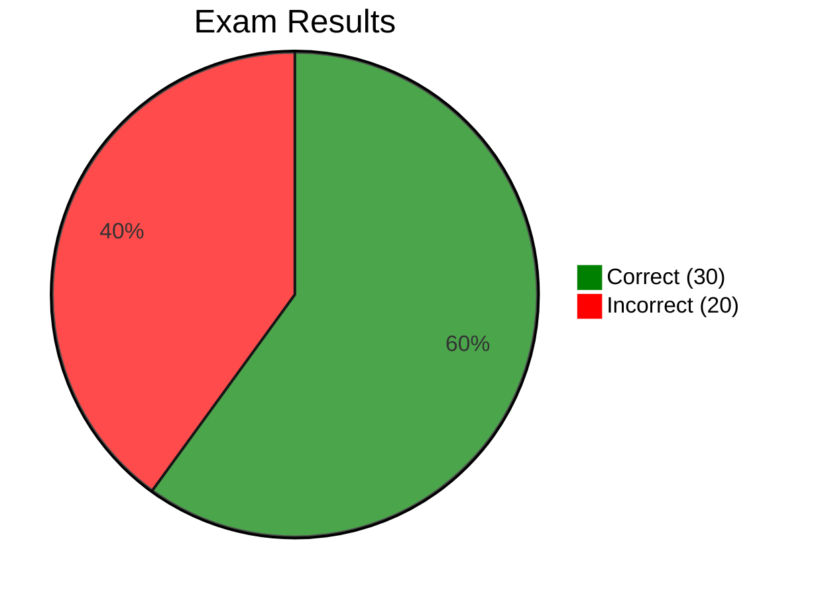

# Practice Exam 4 — Review

[🔙 Back](../../../README.md)

Exam 4 of 6 from [Java 25 Professional Certification - 6 full Tests (1Z0-831)](https://www.udemy.com/course/ocp-oracle-certified-professional-java-developer-prep/).

## 📝 Results

**Score:** 30 / 50 (60%)  
**Pass mark:** 68%  
**Difference from pass:** 4 questions below the pass mark  
**Time taken:** 1 hour 27 minutes  
**Change from PE3:** -9 questions / -18 percentage points

## 🔎 Overview

Practice Exam 4 was the second failing result, following the improvement across PE1 (64%), PE2 (72%) and PE3 (78%).

All 50 questions were reviewed individually, including correct answers where reasoning exposed uncertainty or unfamiliar APIs.

The main findings were:

- **Core APIs and localisation** were significant weaknesses. Date/time formatting, locale concepts and resource bundle fallback caused several lost marks.
- **Class design and language rules** exposed gaps involving records, sealed classes, enum constant bodies, local classes and wrapper comparisons.
- **Collections and generics** were generally understood, but wildcard assignment rules caused confusion.
- **JPMS** knowledge was good for `requires`, `exports` and `opens`, but classpath versus module-path execution needs reinforcement.
- **I/O and NIO** exposed specific gaps in `Externalizable`, `Path.relativize()` and method overloads.
- **Streams** were mostly handled well, although the distinction between generic and primitive stream APIs was missed.
- **Concurrency** was largely strong. The synchronization question was lost because the examiner wanted maximum concurrency rather than merely correct atomicity.
- Several incorrect answers involved **exam precision**, including exact method signatures, inheritance restrictions, compile-time versus runtime behaviour and the meaning of words such as "best".
- Several correct answers demonstrated strong knowledge, particularly effectively final variables, exception inheritance, concurrent collections, pattern matching and try-with-resources.
- Dedicated **JDK 25 addendum features** were not directly tested.

The priority is targeted revision rather than rereading the entire Java syllabus.

---

## ❌ Incorrect Answers (20)

| Question | Area | What Went Wrong | What to Review | Repo Section |
|---|---|---|---|---|
| ❌ Q2 | Wrapper comparisons | Expected wrapper identity comparison when comparing a `Double` with a primitive `double`. | Boxing/unboxing; `==` with wrappers versus primitives; reference equality. | [**04 - Core APIs**](../base/chapter/_04_Core_APIs/README.md) |
| ❌ Q6 | `ISO_LOCAL_DATE_TIME` | Expected formatting without seconds when the seconds value was zero. | `LocalDateTime.toString()` versus `DateTimeFormatter.ISO_LOCAL_DATE_TIME`; mandatory seconds in ISO formatting. | [**04 - Core APIs**](../base/chapter/_04_Core_APIs/README.md) |
| ❌ Q7 | Date/time patterns | Confused `MM` with `MMM` and was uncertain about quoting literal characters. | `M`, `MM`, `MMM`, `MMMM`; `E`/`EEE`; quoting literal text in formatter patterns. | [**04 - Core APIs**](../base/chapter/_04_Core_APIs/README.md) |
| ❌ Q8 | `Locale` | Associated a locale with time zones. | Language, country and cultural conventions versus `ZoneId` and time zones. | [**11 - Exceptions & Localisation**](../base/chapter/_11_Exceptions_and_Localisation/README.md) |
| ❌ Q9 | Record constructors | Did not recognise that a public record requires its canonical constructor to have public access. | Compact constructors; canonical constructor accessibility; records. | [**06 - Class Design**](../base/chapter/_06_Class_Design/README.md) |
| ❌ Q14 | `StringBuilder` capacity | Expected a capacity of 20 rather than 18. | Capacity growth: `max(oldCapacity * 2 + 2, minimumCapacity)`; capacity versus length. | [**04 - Core APIs**](../base/chapter/_04_Core_APIs/README.md) |
| ❌ Q16 | Sealed classes | Was uncertain whether sealed classes can be nested and about restrictions on permitted subclasses. | `sealed`, `non-sealed`, `final`, `abstract`; `permits`; nested sealed classes; module/package restrictions. | [**06 - Class Design**](../base/chapter/_06_Class_Design/README.md) |
| ❌ Q17 | `ServiceLoader` | Did not securely know the distinction between iterating service instances and streaming providers. | `ServiceLoader.load()`, `forEach()`, `stream()` and `Provider.get()`. | [**12 - Modules**](../base/chapter/_12_Modules/README.md) |
| ❌ Q19 | Generic wildcards | Hesitated over adding an object of a subclass through a `? super` reference. | PECS; `? super A` accepting `A` and subclasses; `? extends B` for reading. | [**09 - Collections & Generics**](../base/chapter/_09_Collections_and_Generics/README.md) |
| ❌ Q20 | Records and inheritance | Second-guessed the restriction preventing records from extending ordinary classes. | Records implicitly extend `java.lang.Record`; no explicit class inheritance. | [**06 - Class Design**](../base/chapter/_06_Class_Design/README.md) |
| ❌ Q22 | `Externalizable` | Did not know how externalization differs from ordinary serialization. | `writeExternal()`, `readExternal()`; public methods; constructor requirements; differences from `Serializable`. | [**14 - Input/Output**](../base/chapter/_14_Input_Output/README.md) |
| ❌ Q23 | Enum constant bodies | Expected a method defined only in one constant-specific class body to be callable through the enum type. | Enum constant-specific methods; methods declared on the enum; abstract methods implemented by constants. | [**06 - Class Design**](../base/chapter/_06_Class_Design/README.md) |
| ❌ Q24 | `Path.relativize()` | Expected the target path rather than the relative navigation between two paths. | `relativize()` versus `resolve()`; `..` parent traversal; relative paths. | [**14 - Input/Output**](../base/chapter/_14_Input_Output/README.md) |
| ❌ Q30 | `ISO_LOCAL_DATE_TIME` | Repeated the same error as Q6, omitting `:00` seconds. | ISO formatter output; contrast with `LocalDateTime.toString()`. | [**04 - Core APIs**](../base/chapter/_04_Core_APIs/README.md) |
| ❌ Q31 | Exception handling | Selected additional exceptions that should arguably be avoided in catches; also overlooked an invalid class name. | `Error` versus `Exception`; `StackOverflowError`, `OutOfMemoryError`; checked versus unchecked exceptions. | [**11 - Exceptions & Localisation**](../base/chapter/_11_Exceptions_and_Localisation/README.md) |
| ❌ Q39 | Local classes | Overlooked that the local class was declared in a static method and could not access an enclosing instance field. | Static versus instance context; local classes; enclosing instances; constant variables. | [**06 - Class Design**](../base/chapter/_06_Class_Design/README.md) |
| ❌ Q42 | JPMS execution | Put modular JARs on the module path but a required non-modular dependency on the classpath. Did not consider placing all JARs on the classpath. | Named, automatic and unnamed modules; `-p`, `-cp`, `-m`; module readability. | [**12 - Modules**](../base/chapter/_12_Modules/README.md) |
| ❌ Q47 | `ResourceBundle` fallback | Expected the base properties file immediately after exhausting the requested locale. | Requested locale candidates; JVM default locale candidates; base bundle fallback. | [**11 - Exceptions & Localisation**](../base/chapter/_11_Exceptions_and_Localisation/README.md) |
| ❌ Q48 | Synchronization | Selected synchronized methods, which guarantee atomicity but unnecessarily serialize updates to independent fields. | Separate locks versus a shared monitor; atomicity, contention and concurrency. | [**13 - Concurrency**](../base/chapter/_13_Concurrency/README.md) |
| ❌ Q49 | Stream reductions | Recognised `sum()` and `average()` as reductions but overlooked that they are not methods on generic `Stream<T>`. | `Stream<T>` versus `IntStream`, `LongStream`, `DoubleStream`; reduction operations and method availability. | [**10 - Streams**](../base/chapter/_10_Streams/README.md) |

---

## 🤔 Correct Answers That Exposed Uncertainty (8)

These questions were answered correctly but deserve limited follow-up because the reasoning was not entirely secure.

| Question | Area | Observation | What to Review | Repo Section |
|---|---|---|---|---|
| 🤔 Q11 | Generic methods | Correctly reasoned through two generic type parameters, but initially found the syntax challenging. | Multiple bounded type parameters; generic method invocation. | [**09 - Collections & Generics**](../base/chapter/_09_Collections_and_Generics/README.md) |
| 🤔 Q25 | JPMS objectives | Selected the intended objectives through elimination, but found the wording abstract. | JPMS design objectives; strong encapsulation and reliable configuration. | [**12 - Modules**](../base/chapter/_12_Modules/README.md) |
| 🤔 Q28 | `Locale` construction | Answered correctly according to the practice key, but initially believed a locale always requires a language. | `Locale.of("", "GB")`; optional language; locale components. | [**11 - Exceptions & Localisation**](../base/chapter/_11_Exceptions_and_Localisation/README.md) |
| 🤔 Q33 | `ListResourceBundle` | Correct answer despite unfamiliarity with this particular resource bundle implementation. | `ListResourceBundle.getContents()`; `Object[][]`; `getObject()` versus `getString()`. | [**11 - Exceptions & Localisation**](../base/chapter/_11_Exceptions_and_Localisation/README.md) |
| 🤔 Q35 | Checked exceptions | Took longer to identify the required exception inheritance relationship, but understood it once the `throws` declaration was noticed. | Declared checked exceptions and subtype relationships. | [**11 - Exceptions & Localisation**](../base/chapter/_11_Exceptions_and_Localisation/README.md) |
| 🤔 Q37 | `DecimalFormat` | Correctly applied the French locale and formatting pattern, but initially questioned the `NumberFormat` to `DecimalFormat` cast. | Runtime types, casting, `NumberFormat.getNumberInstance()`. | [**04 - Core APIs**](../base/chapter/_04_Core_APIs/README.md) |
| 🤔 Q38 | Stream reuse | Knew streams could not be reused, but hesitated between compilation failure and runtime exception. | Terminal operations; stream lifecycle; `IllegalStateException`. | [**10 - Streams**](../base/chapter/_10_Streams/README.md) |
| 🤔 Q50 | `Files.copy()` | Selected compilation failure partly by luck, believing that `Files.copy()` always requires two paths. | `Files.copy(Path, Path, CopyOption...)`, `Files.copy(Path, OutputStream)` and `Files.copy(InputStream, Path, CopyOption...)`. | [**14 - Input/Output**](../base/chapter/_14_Input_Output/README.md) |

---

## ✅ Correct Answers Without Significant Concern (22)

The following questions demonstrated sound understanding or confident application of the relevant rules.

| Question | Area | Evidence |
|---|---|---|
| ✅ Q1 | `final` classes | Immediately identified invalid inheritance. |
| ✅ Q3 | `CyclicBarrier` | Correctly reasoned about the barrier action and task execution. |
| ✅ Q4 | Interface methods | Recognised invalid `protected` and `final` method declarations. |
| ✅ Q5 | `CyclicBarrier` | Correctly handled an insufficient number of waiting threads and timeout behaviour. |
| ✅ Q10 | Effectively final variables | Recognised invalid capture of a reassigned local variable. |
| ✅ Q12 | Interfaces | Identified a missing abstract method implementation. |
| ✅ Q13 | Enums | Correctly evaluated enum constants, `values()` and `valueOf()`. |
| ✅ Q15 | `Path` and `Files` | Correctly distinguished path components from file and directory creation. |
| ✅ Q18 | Streams | Correctly applied `filter()` followed by `skip()`. |
| ✅ Q21 | Generics | Recognised that arrays do not support generic type arguments. |
| ✅ Q26 | JPMS | Correctly distinguished `opens` from `exports`. |
| ✅ Q27 | `FileWriter` | Correctly reasoned about character-based I/O. |
| ✅ Q29 | Inner classes | Correctly used `Foo.this` to identify the enclosing instance field. |
| ✅ Q32 | Generic methods | Correctly inferred the required interface implementation relationship. |
| ✅ Q34 | `Path.subpath()` | Immediately applied zero-based, end-exclusive indexing. |
| ✅ Q36 | Local classes | Confidently identified effectively final variables and accessible fields. |
| ✅ Q40 | JPMS | Immediately recognised the dependency created by `requires b`. |
| ✅ Q41 | Concurrent collections | Knew `ConcurrentSkipListSet` maintains sorted order. |
| ✅ Q43 | `final` classes | Recognised the repetition of Q1 and answered immediately. |
| ✅ Q44 | Exception hierarchy | Confident with `RuntimeException`, `Exception` and unchecked exceptions. |
| ✅ Q45 | Try-with-resources | Immediately recognised illegal reassignment of a resource variable. |
| ✅ Q46 | Pattern matching switch | Correctly applied autoboxing and type patterns. |

---

## 📚 Revision Priorities by Chapter

### 🔴 High Priority

| Chapter | Findings | Recommended Revision |
|---|---|---|
| [**04 - Core APIs**](../base/chapter/_04_Core_APIs/README.md) | ❌ Q2, Q6, Q7, Q14, Q30; 🤔 Q37 | ISO date/time formatting, formatter patterns, wrapper comparisons, `StringBuilder` capacity. |
| [**11 - Exceptions & Localisation**](../base/chapter/_11_Exceptions_and_Localisation/README.md) | ❌ Q8, Q31, Q47; 🤔 Q28, Q33, Q35 | Locale components, resource bundle fallback, exception hierarchy and `ListResourceBundle`. |
| [**06 - Class Design**](../base/chapter/_06_Class_Design/README.md) | ❌ Q9, Q16, Q20, Q23, Q39 | Records, sealed classes, enum constant bodies and local classes in static contexts. |

### 🟠 Medium Priority

| Chapter | Findings | Recommended Revision |
|---|---|---|
| [**12 - Modules**](../base/chapter/_12_Modules/README.md) | ❌ Q17, Q42; 🤔 Q25 | `ServiceLoader`, module path versus classpath, automatic and unnamed modules. |
| [**14 - Input/Output**](../base/chapter/_14_Input_Output/README.md) | ❌ Q22, Q24; 🤔 Q50 | `Externalizable`, `Path.relativize()` and `Files.copy()` overloads. |
| [**09 - Collections & Generics**](../base/chapter/_09_Collections_and_Generics/README.md) | ❌ Q19; 🤔 Q11 | PECS, wildcard read/write rules and generic type bounds. |
| [**10 - Streams**](../base/chapter/_10_Streams/README.md) | ❌ Q49; 🤔 Q38 | Generic versus primitive stream methods; terminal operations and stream reuse. |

### 🟢 Lower Priority

| Chapter | Findings | Recommended Revision |
|---|---|---|
| [**13 - Concurrency**](../base/chapter/_13_Concurrency/README.md) | ❌ Q48 | Separate locks versus synchronized methods; atomicity and contention. |
| [**01 - Building Blocks**](../base/chapter/_01_Building_Blocks/README.md) | No specific issue identified | Normal revision only. |
| [**02 - Operators**](../base/chapter/_02_Operators/README.md) | No specific issue identified | Normal revision only. |
| [**03 - Making Decisions**](../base/chapter/_03_Making_Decisions/README.md) | Pattern matching switch answered correctly | Normal revision only. |
| [**05 - Methods**](../base/chapter/_05_Methods/README.md) | No significant issue identified | Normal revision only. |
| [**07 - Beyond Classes**](../base/chapter/_07_Beyond_Classes/README.md) | No separate issue identified beyond class-design topics | Normal revision only. |
| [**08 - Lambdas & Functional Interfaces**](../base/chapter/_08_Lambdas_and_Functional_Interfaces/README.md) | No specific issue identified | Normal revision only. |

### Evidence Key

- ❌ **Incorrect** — demonstrated mistake or knowledge gap
- 🤔 **Correct but uncertain** — deduction, hesitation or incomplete API knowledge
- ✅ **Confident** — correct without identified concern
- 🔴 **High priority** — several mistakes or repeated issues
- 🟠 **Medium priority** — specific revision required
- 🟢 **Low priority** — maintain existing knowledge

---

## 🔁 Recurring Issues Across Practice Exams

Several PE4 findings reinforce patterns already identified in PE1–PE3.

### 1. Exact API Knowledge

This remains one of the strongest recurring themes.

Examples across the exams include:

- `Collectors.joining()` argument order
- `BinaryOperator.maxBy()`
- `Integer.decode()`
- `StringBuilder` methods and capacity
- `Files` method overloads
- `Stream<T>` versus primitive stream methods
- Date/time formatting symbols

**Recommendation:** Practise recognising method signatures, return types and overloads rather than relying solely on conceptual understanding.

### 2. Date/Time and Localisation

Earlier exams exposed uncertainty with `SimpleDateFormat` and `DateTimeFormatter`.

PE4 added:

- Two identical mistakes involving `ISO_LOCAL_DATE_TIME`
- Formatter pattern symbols
- `Locale` versus time zone
- JVM default locale versus base resource bundle
- Unfamiliarity with `ListResourceBundle`

**Recommendation:** Treat formatting and localisation as a priority before PE5.

### 3. Compilation Rules and Language Restrictions

PE4 exposed several precise rules involving:

- Records and inheritance
- Compact constructor accessibility
- Sealed classes
- Enum constant-specific bodies
- Local classes inside static methods
- Wrapper comparisons

**Recommendation:** Use short code snippets and predict whether each compiles before checking the result.

### 4. I/O and NIO

I/O has appeared repeatedly across the practice exams.

PE4 highlighted:

- `Externalizable`
- `Path.relativize()`
- `Files.copy()` overloads

**Recommendation:** Review API signatures and compare closely related methods.

### 5. Exam Technique

PE4 demonstrated several avoidable losses:

- Missing the precise interface named in a question
- Overlooking the direction of a dependency
- Interpreting "best" as merely "correct"
- Second-guessing established language rules
- Failing to notice a static context
- Repeating an earlier formatting mistake

**Recommendation:** Read the question's final sentence carefully and distinguish compilation, runtime behaviour and best-practice questions.

---

## JDK 25 Addendum

Practice Exam 4 did not appear to directly test any dedicated Java 25 addendum topics.

| Addendum Topic | Exam 4 Finding |
|---|---|
| [Flexible Constructor Bodies (JEP 513)](../addendum/Flexible_Constructor_Bodies/README.md) | Not directly tested |
| [Unnamed Variables and Patterns (`_`)](../addendum/Unnamed_Variables/README.md) | Not directly tested |
| [Module Import Declarations (JEP 511)](../addendum/Module_Import_Declarations/README.md) | Not directly tested |
| [Compact Source Files and Instance Main Methods (JEP 512)](../addendum/Compact_Source_Files_and_Instance_Main_Methods/README.md) | Not directly tested |
| [Stream Gatherers](../addendum/Stream_Gatherers/README.md) | Not directly tested |
| [Scoped Values (JEP 506)](../addendum/Scoped_Values/README.md) | Not directly tested |
| [Minor API Additions](../addendum/Minor_Api_Additions/README.md) | Not directly tested |

The module questions tested established JPMS behaviour, not module import declarations. The stream questions tested established stream operations, not Stream Gatherers.

These subjects still require separate revision because their absence from the practice exams does not establish exam readiness.

---

## Overall Assessment

**PE4 scored 60%, four questions below the 68% pass threshold.**

The result interrupts the improvement seen across PE1–PE3:

| Practice Exam | Score | Result |
|---|---|---|
| PE1 | 32/50 — 64% | ❌ Fail |
| PE2 | 36/50 — 72% | ✅ Pass |
| PE3 | 39/50 — 78% | ✅ Pass |
| PE4 | 30/50 — 60% | ❌ Fail |

The four-exam average is **68.5%**, narrowly above the practice pass threshold.

However, this average should not be treated as a reliable prediction of the certification result. The variation between exams is substantial.

PE4's individual review provides a more useful picture than the score alone:

- Fundamental Java understanding remains strong in many areas.
- Several mistakes involved narrow API rules rather than entire topics.
- Localisation and formatting have become clear recurring priorities.
- Class design contains several exam-specific edge cases requiring consolidation.
- Modules and I/O need targeted practice.
- Question interpretation and exam precision contributed to some incorrect answers.
- The Java 25-specific additions still need independent coverage.

The immediate objective is to strengthen these areas and assess the effectiveness of that revision in the next practice exam.

**The goal is not to memorise PE4 answers. It is to recognise the underlying rules quickly and confidently when they appear in unfamiliar questions.**
