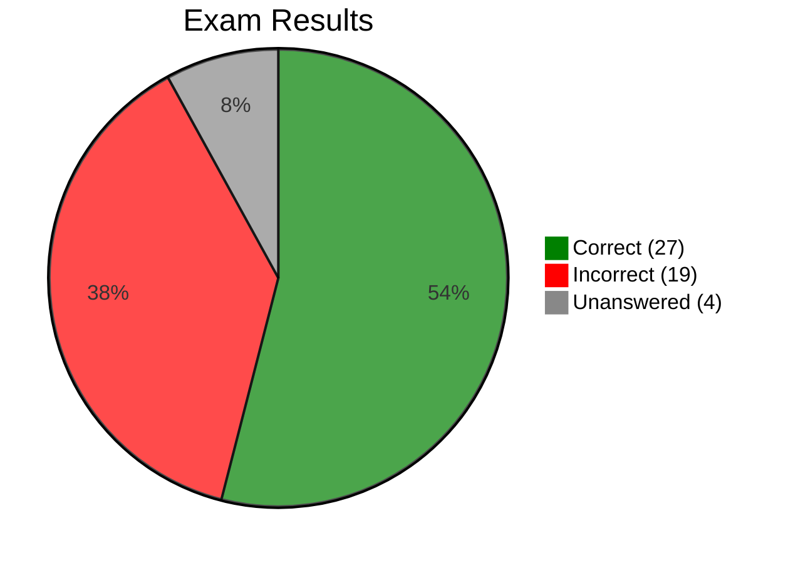

# Practice Exam 5 — Review

[🔙 Back](../../../README.md)

Exam 5 of 6 from [Java 25 Professional Certification - 6 full Tests (1Z0-831)](https://www.udemy.com/course/ocp-oracle-certified-professional-java-developer-prep/).

## 📝 Results

**Score:** 27 / 50 (54%)  
**Pass mark:** 68%  
**Difference from pass:** 7 questions below the pass mark  
**Time taken:** 2hr - hence, unanswered questions  
**Change from PE4:** -3 questions / -6 percentage points  
**Breakdown:** 27 correct, 19 incorrect, 4 unanswered

## 🔎 Overview

Practice Exam 5 scored 54%, following PE4's 60%. All 50 questions were subsequently reviewed, including the four unanswered questions, with attention to whether the underlying Java rule was understood.

The main findings were:

- **Compilation-first analysis** is the highest-value exam technique. Several questions could be resolved by checking static context, scope, invalid expressions or constructor syntax before tracing runtime behaviour.
- **Object identity and reachability** require more precise reference tracking: shallow copying, collection-held references, instance fields, and array evaluation order.
- **Serialization** exposed a genuine gap involving record canonical constructors, enum initialisation and ordinary serializable class construction.
- **Concurrency** needs targeted reinforcement around class versus instance monitors and executor shutdown, queued tasks and barrier deadlock.
- **Exact APIs** caused difficulty: `String.splitWithDelimiters()`, `ServiceLoader`, `Map.computeIfAbsent()`, text-block line endings and JDK command-line tools.
- **Streams** were generally understood conceptually. A parallel `reduce()` question was solved correctly during review; a complex pipeline was answered correctly without secure reasoning.
- **Several unanswered questions were solvable during review**, notably parallel reduction and interface/default-method dispatch. They should not be treated as wholly unfamiliar subjects.
- **Order and guarantees** matter: immutable collection factories do not guarantee iteration order, and operations that produce a particular output are not necessarily guaranteed to produce it.

The priority is to address specific language and API gaps, supported by small runnable examples, rather than repeat the whole syllabus.

---

## 🔴 ❌ Incorrect Answers (19)

| Question | Area | What Went Wrong | What to Review | Repo Section |
|---|---|---|---|---|
| 🔴 ❌ Q3 | Cloning and defensive copying | Treated copying an `ArrayList` as sufficient to copy its mutable elements; `clone()` availability and accessibility were unclear. | Shallow versus deep copy; `ArrayList.clone()`; `Cloneable`, `Object.clone()` and checked exceptions. | [**06 - Class Design**](../base/chapter/_06_Class_Design/README.md) |
| 🔴 ❌ Q4 | Immutable maps | Expected `computeIfAbsent()` to work on a map created by `Map.of()`. | Optional mutator operations; `UnsupportedOperationException`; immutable map behaviour. | [**09 - Collections & Generics**](../base/chapter/_09_Collections_and_Generics/README.md) |
| 🔴 ❌ Q6 | `finally` | Missed that an unconditional `return` in `finally` suppresses a pending checked exception. | Abrupt completion of `finally`; overriding pending returns and exceptions. | [**11 - Exceptions & Localisation**](../base/chapter/_11_Exceptions_and_Localisation/README.md) |
| 🔴 ❌ Q8 | Text blocks | Did not know that text-block source line terminators are normalised to LF. | Text-block line endings and escape processing. | [**04 - Core APIs**](../base/chapter/_04_Core_APIs/README.md) |
| 🔴 ❌ Q15 | Lambda overload resolution | Treated a block lambda containing a method call as though it implicitly returned the call's result. | Void-compatible block lambdas; expression versus block bodies; overloaded functional interfaces. | [**08 - Lambdas & Functional Interfaces**](../base/chapter/_08_Lambdas_and_Functional_Interfaces/README.md) |
| 🔴 ❌ Q17 | Synchronisation | Did not distinguish the monitor of a static synchronized method from monitors belonging to separate instances. | Class locks versus object locks; simultaneous execution across instances. | [**13 - Concurrency**](../base/chapter/_13_Concurrency/README.md) |
| 🔴 ❌ Q18 | `Path` components | Counted the working directory as a name component despite calling `getRoot()`; expected path normalisation. | `getRoot()`, `resolve()`, `getName()`; roots excluded from name indices; `..` retained until `normalize()`. | [**14 - Input/Output**](../base/chapter/_14_Input_Output/README.md) |
| 🔴 ❌ Q20 | JDK tools | Confused `jlink` and `jimage`, and was uncertain about related packaging tools. | `javac`, `java`, `jar`, `jmod`, `jlink`, `jimage`, `jpackage`, `jdeps` comparison. | [**12 - Modules**](../base/chapter/_12_Modules/README.md) |
| 🔴 ❌ Q22 | Increment expressions | Focused on runtime failures instead of identifying the one invalid expression at compile time. | `(i--)--` is not a variable; unboxing `null`; compilation versus execution. | [**02 - Operators**](../base/chapter/_02_Operators/README.md) |
| 🔴 ❌ Q23 | `ServiceLoader` | Confused the pre-JPMS service configuration mechanism with module declarations and service loader return types. | `META-INF/services` versus `uses`/`provides`; `load()`, `iterator()`, `stream()`; provider factories. | [**12 - Modules**](../base/chapter/_12_Modules/README.md) |
| 🔴 ❌ Q26 | Collection ordering | Lost track of which collection received `addAll()` and the resulting deque order. | `TreeSet` sorting; `ArrayDeque` insertion at head/tail; `add()`, `offer()`, `push()`, `addFirst()`; initial capacity. | [**09 - Collections & Generics**](../base/chapter/_09_Collections_and_Generics/README.md) |
| 🔴 ❌ Q27 | Instance fields and loops | Expected a duplicate-year exception, overlooking that each `Car` had its own list and the loop skipped the last element. | Instance versus static fields; `i < size() - 1`; boundary conditions. | [**03 - Making Decisions**](../base/chapter/_03_Making_Decisions/README.md) |
| 🔴 ❌ Q28 | Object state | Assessed only the first invocation, missing that the method progressively shortened an instance field on repeated calls. | Local variables versus fields; state mutation; repeat-call correctness. | [**06 - Class Design**](../base/chapter/_06_Class_Design/README.md) |
| 🔴 ❌ Q29 | Evaluation order | Evaluated an index assignment before capturing the outer array reference. | Java's left-to-right array-access evaluation; reference evaluated before index. | [**02 - Operators**](../base/chapter/_02_Operators/README.md) |
| 🔴 ❌ Q33 | Garbage collection | Assumed nulling a local map reference also removed a reference previously stored in a static list. | Reference copies in collections; object graphs; GC reachability. | [**06 - Class Design**](../base/chapter/_06_Class_Design/README.md) |
| 🔴 ❌ Q34 | Class and local-variable rules | Overlooked anonymous classes and legal reuse of local variable names in non-overlapping scopes. | Anonymous classes; nested scopes; local-variable shadowing and redeclaration restrictions. | [**01 - Building Blocks**](../base/chapter/_01_Building_Blocks/README.md) |
| 🔴 ❌ Q42 | Map iteration order | Selected a valid way to calculate `37`, but not one guaranteed to print `37` in that order. | Unspecified `Map.of()` iteration order; `keySet()`, `entrySet()`, `forEach()`; `Map` is not `Iterable`. | [**09 - Collections & Generics**](../base/chapter/_09_Collections_and_Generics/README.md) |
| 🔴 ❌ Q44 | Constructors and GC | Missed that `void Car()` is a method, leaving the engine field null; the list's last `Car` reference was replaced at n3. | Constructor syntax; `List.add(index, ...)` versus `set(index, ...)`; reachability. | [**06 - Class Design**](../base/chapter/_06_Class_Design/README.md) |
| 🔴 ❌ Q45 | Scope and arithmetic | Followed an anticipated exception path without first checking that `try`-local variables were inaccessible in `catch`. | Block scope; integer versus floating-point division by zero; `Infinity`, `-Infinity`, `NaN`. | [**11 - Exceptions & Localisation**](../base/chapter/_11_Exceptions_and_Localisation/README.md) |

---

## 🔵 ⏭️ Unanswered Questions (4)

These were attempted again during review. Distinguishing a new API from a readily solvable question is important for efficient revision.

| Question | Area | Review Finding | What to Review | Repo Section |
|---|---|---|---|---|
| 🔵 ⏭️ Q46 | Parallel `reduce()` | Correctly identified the erroneous multiplication combiner on a fresh attempt. | Three-argument `reduce()`; identity, accumulator, combiner; parallel compatibility. | [**10 - Streams**](../base/chapter/_10_Streams/README.md) |
| 🔵 ⏭️ Q47 | `splitWithDelimiters()` | Genuine unfamiliarity with the method and positive/zero/negative `limit` semantics. | Retained delimiters; regex `+`; at most `limit - 1` matches for positive limits. | [**04 - Core APIs**](../base/chapter/_04_Core_APIs/README.md) |
| 🔵 ⏭️ Q49 | Interface defaults | Correctly derived `Chicken.fly()` dispatch during review. | Abstract redeclaration of a default method; reference type versus runtime dispatch. | [**07 - Beyond Classes**](../base/chapter/_07_Beyond_Classes/README.md) |
| 🔵 ⏭️ Q50 | Record deserialization | Uncertain whether record and enum constructors run during deserialization. | Canonical record constructor; enum constant resolution; first-time enum initialisation; ordinary `Serializable` rules. | [**14 - Input/Output**](../base/chapter/_14_Input_Output/README.md) |

---

## 🟢 🤔 Correct Answers That Exposed Uncertainty (13)

These questions were answered correctly, but the review identified a useful clarification, unfamiliar API or exam technique.

| Question | Area | Observation | What to Review | Repo Section |
|---|---|---|---|---|
| 🟢 🤔 Q5 | `FileChannel` | Correct answer despite limited familiarity with file locking. | `FileOutputStream.getChannel()`; `FileChannel.tryLock()`; lock acquisition. | [**14 - Input/Output**](../base/chapter/_14_Input_Output/README.md) |
| 🟢 🤔 Q7 | Unordered streams | Correctly reasoned about unordered `Set.of()` streams but required careful analysis. | `takeWhile()`/`dropWhile()` on unordered streams; `filter()` distinction. | [**10 - Streams**](../base/chapter/_10_Streams/README.md) |
| 🟢 🤔 Q9 | Fields and methods | Correct result after tracing compile-time field access and runtime overriding. | Hidden fields versus overridden methods; overload resolution. | [**06 - Class Design**](../base/chapter/_06_Class_Design/README.md) |
| 🟢 🤔 Q10 | `Function.identity()` | Correctly chose `mapToInt()`, but was uncertain about functional-interface types. | `Function<T,T>` versus `ToIntFunction<T>`; `map()` versus `mapToInt()`. | [**10 - Streams**](../base/chapter/_10_Streams/README.md) |
| 🟢 🤔 Q11 | `String.repeat()` | Correctly inferred the return type of `repeat(int)` in a lambda. | `String.repeat()` behaviour and functional-interface signature. | [**04 - Core APIs**](../base/chapter/_04_Core_APIs/README.md) |
| 🟢 🤔 Q13 | `PrintWriter` | Correctly selected the result, but exact method return types were uncertain. | `printf()`/`format()` return `PrintWriter`; `print()`/`println()` return `void`; `checkError()`. | [**14 - Input/Output**](../base/chapter/_14_Input_Output/README.md) |
| 🟢 🤔 Q14 | Hash codes and `%` | Correctly recognised possible index failure, but initially attributed it to an excessively large remainder rather than a negative one. | Negative hash codes; Java remainder sign; `Math.floorMod()`. | [**02 - Operators**](../base/chapter/_02_Operators/README.md) |
| 🟢 🤔 Q21 | Serialization of object graphs | Correct answer with a useful distinction between ignoring a non-serializable field and preserving its data. | `transient`; custom `writeObject()`/`readObject()`; nested serializability. | [**14 - Input/Output**](../base/chapter/_14_Input_Output/README.md) |
| 🟢 🤔 Q25 | For-loop control | Correctly traced unusual update/body expressions. | For-loop execution order; side effects. | [**03 - Making Decisions**](../base/chapter/_03_Making_Decisions/README.md) |
| 🟢 🤔 Q32 | Eager versus lazy arguments | Correctly identified eager evaluation and the `Supplier` solution. | Argument evaluation order; `Supplier` for deferred execution. | [**08 - Lambdas & Functional Interfaces**](../base/chapter/_08_Lambdas_and_Functional_Interfaces/README.md) |
| 🟢 🤔 Q37 | Executors and barriers | Correctly identified that two worker threads cannot satisfy a three-party barrier, but executor shutdown behaviour needs examples. | `shutdown()`, `shutdownNow()`, `awaitTermination()`; queued tasks; interruption. | [**13 - Concurrency**](../base/chapter/_13_Concurrency/README.md) |
| 🟢 🤔 Q40 | Stream pipeline and compilation | Correct answer without a secure explanation; significant time was spent evaluating a pipeline before noticing the non-static method call. | Static versus instance calls; `reduce()` as terminal operation; `splitAsStream()`. | [**10 - Streams**](../base/chapter/_10_Streams/README.md) |
| 🟢 🤔 Q43 | `Period.normalized()` | Correctly inferred behaviour from the API name rather than prior study. | Normalize months into years; days remain unchanged. | [**04 - Core APIs**](../base/chapter/_04_Core_APIs/README.md) |

---

## 🟢 ✅ Correct Answers Without Significant Concern (14)

| Question | Area | Evidence |
|---|---|---|
| 🟢 ✅ Q1 | `Optional` | Correctly handled empty filtering and conditional output. |
| 🟢 ✅ Q2 | `LocalDate` | Correctly advanced a birthday using calendar years/months rather than fixed day counts. |
| 🟢 ✅ Q12 | Date/time formatting | Recognised that `LocalDate` cannot supply time fields for formatting. |
| 🟢 ✅ Q16 | Stream matching | Selected efficient, short-circuiting `anyMatch()`. |
| 🟢 ✅ Q19 | Effectively final | Distinguished reassignment of a captured variable from mutation of an object. |
| 🟢 ✅ Q24 | Packages and interfaces | Identified that an unrelated class does not implement an interface merely by matching a method signature. |
| 🟢 ✅ Q30 | `Optional` | Correctly followed lazy `or()`, `flatMap()` and fallback behaviour. |
| 🟢 ✅ Q31 | Static fields | Correctly tracked shared static state across new instances. |
| 🟢 ✅ Q35 | Garbage collection | Correctly traced multiple field references and the last reachable reference. |
| 🟢 ✅ Q36 | Zoned date/time | Correctly calculated elapsed time across time zones and DST. |
| 🟢 ✅ Q38 | `Optional.get()` | Recognised `NoSuchElementException` for an empty optional. |
| 🟢 ✅ Q39 | Lambda overloads | Correctly distinguished abstract `int` method from default `long` overload. |
| 🟢 ✅ Q41 | Exception handling | Correctly traced catch, rethrow and `finally`. |
| 🟢 ✅ Q48 | Text blocks | Confidently identified three valid text-block declarations and invalid opening/escape syntax. |

---

## 📚 Revision Priorities by Chapter

### 🔴 High Priority

| Chapter | Findings | Recommended Revision |
|---|---|---|
| [**06 - Class Design**](../base/chapter/_06_Class_Design/README.md) | 🔴 ❌ Q3, Q28, Q33, Q44; 🟢 🤔 Q9 | Defensive copying and `clone()`; field references and reachability; constructor syntax; state mutation. |
| [**14 - Input/Output**](../base/chapter/_14_Input_Output/README.md) | 🔴 ❌ Q18; 🔵 ⏭️ Q50; 🟢 🤔 Q5, Q13, Q21 | Serialization of records/enums; `Path` components; `FileChannel` and `PrintWriter` signatures. |
| [**13 - Concurrency**](../base/chapter/_13_Concurrency/README.md) | 🔴 ❌ Q17; 🟢 🤔 Q37 | Object/class monitors; executor lifecycle, queued tasks, barrier behaviour and interruption. |
| [**04 - Core APIs**](../base/chapter/_04_Core_APIs/README.md) | 🔴 ❌ Q8; 🔵 ⏭️ Q47; 🟢 🤔 Q11, Q43 | `splitWithDelimiters()`; text-block line endings; `Period.normalized()`; `String.repeat()`. |
| [**02 - Operators**](../base/chapter/_02_Operators/README.md) | 🔴 ❌ Q22, Q29; 🟢 🤔 Q14 | Array evaluation order; valid increment targets; negative remainder. |

### 🟠 Medium Priority

| Chapter | Findings | Recommended Revision |
|---|---|---|
| [**09 - Collections & Generics**](../base/chapter/_09_Collections_and_Generics/README.md) | 🔴 ❌ Q4, Q26, Q42 | Immutable map operations; deque head/tail operations; unspecified collection iteration order. |
| [**12 - Modules**](../base/chapter/_12_Modules/README.md) | 🔴 ❌ Q20, Q23 | JDK tools comparison; `ServiceLoader` and JPMS provider declarations. |
| [**11 - Exceptions & Localisation**](../base/chapter/_11_Exceptions_and_Localisation/README.md) | 🔴 ❌ Q6, Q45 | `finally` completion; catch-block scope; floating-point versus integer division by zero. |
| [**08 - Lambdas & Functional Interfaces**](../base/chapter/_08_Lambdas_and_Functional_Interfaces/README.md) | 🔴 ❌ Q15; 🟢 🤔 Q32 | Block-lambda return compatibility; eager arguments versus lazy suppliers. |
| [**10 - Streams**](../base/chapter/_10_Streams/README.md) | 🔵 ⏭️ Q46; 🟢 🤔 Q7, Q10, Q40 | Parallel reduction combiners; unordered streams; primitive stream methods; terminal operations. |

### 🟢 Lower Priority

| Chapter | Findings | Recommended Revision |
|---|---|---|
| [**01 - Building Blocks**](../base/chapter/_01_Building_Blocks/README.md) | 🔴 ❌ Q34 | Anonymous classes and local-variable scope; brief refresher. |
| [**03 - Making Decisions**](../base/chapter/_03_Making_Decisions/README.md) | 🔴 ❌ Q27; 🟢 🤔 Q25 | Loop bounds and update expressions; brief refresher. |
| [**07 - Beyond Classes**](../base/chapter/_07_Beyond_Classes/README.md) | 🔵 ⏭️ Q49 | Abstract redeclaration of interface default methods; already solved during review. |
| [**05 - Methods**](../base/chapter/_05_Methods/README.md) | No separate issue identified | Normal revision only. |

### Evidence Key

- 🔴 ❌ **Incorrect** — incorrect practice answer; may reflect a knowledge gap or exam precision issue
- 🔵 ⏭️ **Unanswered** — skipped in the practice exam and revisited during review
- 🟢 🤔 **Correct but uncertain** — deduction, unfamiliar API or incomplete reasoning
- 🟢 ✅ **Confident** — correct without significant concern
- 🔴 **High priority** — important or repeated gaps
- 🟠 **Medium priority** — targeted revision required
- 🟢 **Low priority** — brief reinforcement only

---

## 🔁 Recurring Issues Across Practice Exams

### 1. Exact API Knowledge

PE4 highlighted `Files.copy()`, `ServiceLoader`, primitive streams and formatting APIs. PE5 adds `splitWithDelimiters()`, `Period.normalized()`, `Map.computeIfAbsent()`, `FileChannel` and command-line tooling.

**Recommendation:** Add concise signature and behaviour comparisons to the relevant guides. Prefer short runnable examples for unfamiliar APIs.

### 2. Serialization and Object Construction

PE4 exposed `Externalizable`; PE5 added ordinary `Serializable`, record canonical constructors, enum deserialization and mutable-object copying.

**Recommendation:** Create a focused serialization guide with a companion runnable example, and a separate cloning/defensive-copying example.

### 3. Compilation Rules and Evaluation Order

PE5 repeatedly rewarded checking compilation before calculating output:

- Static versus instance method calls (Q40)
- Variables declared inside `try` and referenced in `catch` (Q45)
- A method mistaken for a constructor because it has the class name (Q44)
- Invalid increment target (Q22)
- Array-reference evaluation before index evaluation (Q29)
- Void-compatible versus value-returning lambda bodies (Q15)

**Recommendation:** Scan declarations, types, scope and method context first. Only trace output after establishing that the code compiles.

### 4. References, Reachability and Mutable State

PE5 highlighted copying references into collections (Q33), distinct per-instance fields (Q27), shallow copying (Q3), and methods that mutate persistent fields (Q28).

**Recommendation:** Draw object/reference diagrams for difficult GC questions; track references held by fields and collections independently of local variables.

### 5. Concurrency and Stream Execution

PE4 tested lock granularity; PE5 tested class versus instance monitors and thread-pool/barrier behaviour. Parallel `reduce()` was solved during review but remains worth a short reminder.

**Recommendation:** Pair an executor lifecycle guide with runnable code and diagrams. Reinforce the difference between a correct accumulator and a compatible parallel combiner.

### 6. Exam Precision

Several questions turned on a single qualifying detail:

- **Guaranteed** output versus one possible output (Q42)
- **Compilation** versus runtime behaviour (Q22, Q40, Q45)
- **First call** versus repeated calls (Q28)
- **Correct result** versus correct parallel semantics (Q46)
- **`Map.of()`/`Set.of()`** versus collections with defined iteration order (Q7, Q42)

**Recommendation:** Read the final question sentence first, then inspect compilation and API contracts before following the execution path.

---

## 🛠️ Targeted Revision Deliverables

Keep detailed code out of the exam review. The following are the companion materials identified during the question-by-question discussion, in recommended priority order.

| Priority | Deliverable | Format | Covers |
|---|---|---|---|
| 1 | Serialization, records and enums | Guide update + runnable Java example | Q21, Q44, Q50; ordinary deserialization versus record canonical constructors and enum initialisation |
| 1 | Cloning and defensive copying | Focused guide + runnable Java example | Q3; shallow versus deep copy, `Cloneable` and `clone()` |
| 2 | Executor lifecycle and synchronization | Support guide with diagrams + runnable Java example | Q17, Q37; `shutdown()`, `shutdownNow()`, `awaitTermination()`, monitors and barriers |
| 3 | String API updates | Existing guide update + small example | Q47; `splitWithDelimiters(regex, limit)` including `2`, `5`, `0`, `-1` |
| 3 | Core API edge cases | Existing guide updates | Q8, Q14, Q43, Q45; text-block newlines, `floorMod()`, `Period.normalized()`, floating-point division |
| 4 | Evaluation order and compilation traps | Short support guide + runnable Java examples | Q6, Q15, Q22, Q29, Q40, Q45 |
| 4 | Object references and state | Short support guide + runnable Java examples | Q27, Q28, Q33, Q44 |
| 5 | JDK command-line tools | One comparison table | Q20; `java`, `javac`, `jar`, `jmod`, `jlink`, `jimage`, `jpackage`, `jdeps` |
| 5 | Service loading and collections | Existing guide updates | Q4, Q23, Q26, Q42; service providers, immutable maps, deque operations and order guarantees |
| 5 | Parallel reduction and paths | Brief existing-guide updates | Q18, Q46; `Path.getRoot()`/`getName()` and compatible reduction combiners |

These deliverables can be grouped into five study sessions: **serialization/copying; concurrency; API updates; compilation/reference tracing; and tooling/remaining comparisons**.

---

## JDK 25 Addendum

Practice Exam 5 did not appear to directly test the dedicated Java 25 language or platform addendum topics. Some questions involved relatively recent APIs, including Java 21's `String.splitWithDelimiters()`, but that is not a Java 25-specific feature.

| Addendum Topic | Exam 5 Finding |
|---|---|
| [Flexible Constructor Bodies (JEP 513)](../addendum/Flexible_Constructor_Bodies/README.md) | Not directly tested |
| [Unnamed Variables and Patterns (`_`)](../addendum/Unnamed_Variables/README.md) | Not directly tested; Q34 concerned ordinary class and variable naming rules |
| [Module Import Declarations (JEP 511)](../addendum/Module_Import_Declarations/README.md) | Not directly tested |
| [Compact Source Files and Instance Main Methods (JEP 512)](../addendum/Compact_Source_Files_and_Instance_Main_Methods/README.md) | Not directly tested |
| [Stream Gatherers](../addendum/Stream_Gatherers/README.md) | Not directly tested |
| [Scoped Values (JEP 506)](../addendum/Scoped_Values/README.md) | Not directly tested |
| [Minor API Additions](../addendum/Minor_Api_Additions/README.md) | No dedicated Java 25 minor API addition clearly tested |

Continue independent Java 25 addendum revision rather than inferring coverage from the practice exams.

---

## Overall Assessment

**PE5 scored 54%, seven questions below the 68% pass threshold.**

| Practice Exam | Score | Result |
|---|---|---|
| PE1 | 32/50 — 64% | 🔴 ❌ Fail |
| PE2 | 36/50 — 72% | 🟢 ✅ Pass |
| PE3 | 39/50 — 78% | 🟢 ✅ Pass |
| PE4 | 30/50 — 60% | 🔴 ❌ Fail |
| PE5 | 27/50 — 54% | 🔴 ❌ Fail |

The five-exam average is **65.6%**, below the practice pass threshold. This average is descriptive, not a prediction of the certification result.

The individual review provides a more actionable picture:

- There are **19 incorrect answers and four unanswered questions**, but several were resolved accurately during review.
- The most valuable genuine gaps concern **serialization, cloning, selected API contracts and concurrency lifecycle behaviour**.
- A number of mistakes reflect **compilation-first technique**, reference tracking or precise question wording rather than broad conceptual weaknesses.
- **Parallel reduction, interface dispatch and text-block validity** were handled well when examined directly.
- The next practice exam should test whether targeted revision improves both accuracy and speed on unfamiliar code.

**The objective is to recognise the Java rule quickly, verify that the code compiles, and distinguish possible behaviour from guaranteed behaviour.**
